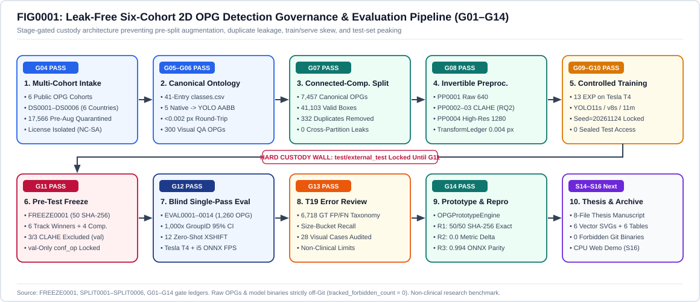
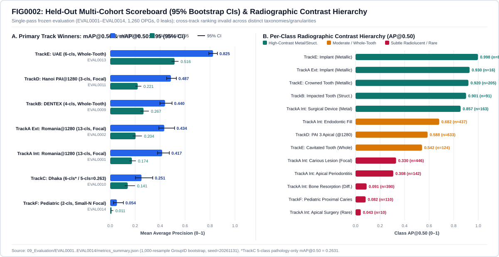
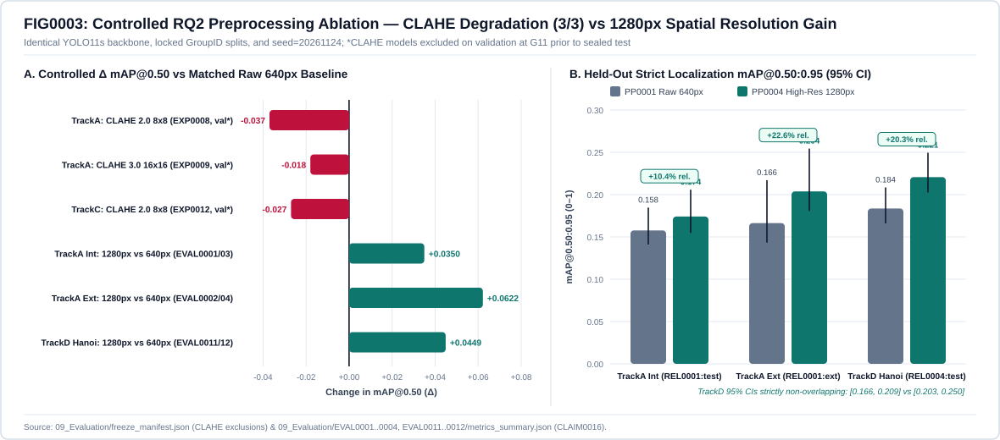
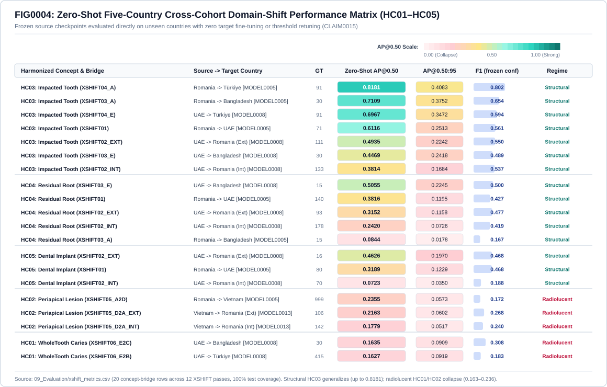
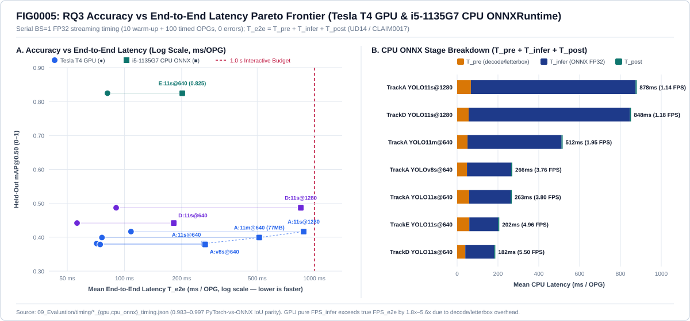
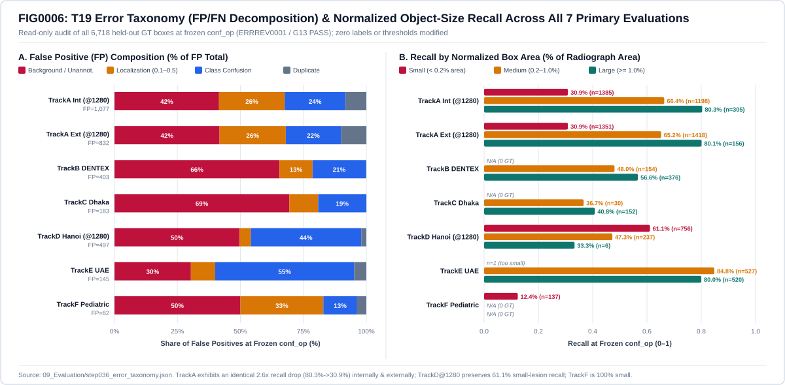

# Front Matter, Institutional Declarations & Abstract (`WRIT0001`)

> **Manuscript Status:** `STEP-041` Assets, Citations & Claims Verified Draft (`v1.0.1`, `2026-11-21`; audit: `11_Writing/reviews/STEP041_citation_claim_asset_audit.md`).  
> **Pending Institutional Confirmations (`DEC0017` / `UD17`):** Exact final defense date and official DIU CSE formatting/cover template confirmation remain pending Supervisor Ms Faiza Feroz sign-off before `G15`.

---

## Title Page

**A Deep Learning-Based Approach for Automated Object Detection in Orthopantomogram (OPG) Images Using YOLO**

A Thesis Submitted to the Department of Computer Science and Engineering in Partial Fulfillment of the Requirements for the Degree of **Bachelor of Science in Computer Science and Engineering**

**Submitted By:**
- **Akhtaruzzaman Anik** — Student ID: `232-15-252` *(Data Stewardship, Preprocessing, Research Prototype & Reproducibility Lead)*
- **Mahajub Al Shabah** — Student ID: `232-15-900` *(Literature Review, Annotation QA, Modeling & Evaluation Lead)*

**Supervised By:**
- **Ms Faiza Feroz** — Lecturer, Department of Computer Science and Engineering (Supervisor)
- **Israt Jahan** — Senior Lecturer, Department of Computer Science and Engineering (Co-supervisor)

**Department of Computer Science and Engineering**  
**Daffodil International University (DIU)**  
**Dhaka, Bangladesh**  
*[Final Defense Month / Year — Pending Institutional Calendar Confirmation under `UD17`]*

---

## Declaration of Originality

We hereby declare that this thesis, titled *"A Deep Learning-Based Approach for Automated Object Detection in Orthopantomogram (OPG) Images Using YOLO"*, is our own original work prepared under the supervision of Ms Faiza Feroz and Israt Jahan in the Department of Computer Science and Engineering, Daffodil International University. All primary literature references are drawn exclusively from our verified canonical bibliography (`02_Literature/references.bib`), all six secondary panoramic radiograph datasets are properly attributed under their original source licenses, and every quantitative metric, confidence interval, error count, and timing figure is programmatically reconciled to locked evaluation artifacts (`FREEZE0001`, `G01–G14 PASS`).

- **Akhtaruzzaman Anik (`232-15-252`)** — Signature: `______________________` Date: `____________`
- **Mahajub Al Shabah (`232-15-900`)** — Signature: `______________________` Date: `____________`

---

## Non-Clinical Research Scope Statement

This research evaluates deep-learning object detection strictly on secondary, de-identified 2D orthopantomogram (OPG) radiographs as an **academic research benchmark and supplementary research prototype**. None of the trained models (`MODEL0001–MODEL0013`) or software interfaces (`OPGPrototypeEngine`) constitute a certified medical device or validated clinical diagnostic aid. Predicted confidence scores are not clinical diagnostic probabilities, **zero predicted bounding boxes never exclude dental disease**, and all radiographic interpretation must be performed independently by a qualified dental clinician.

---

## Abstract

Panoramic dental radiography—orthopantomography (OPG)—is among the most widely acquired full-arch screening modalities in dentistry, yet automated multi-object detection on 2D OPGs faces severe methodological pitfalls across the published literature. A systematic audit of `122` screened publications (`42` verified full-text Core studies) reveals that `84.9%` (`62/73`) of prior dental YOLO studies omit strict multi-threshold localization (`mAP@0.50:0.95`), `87.7%` (`64/73`) lack external validation, `73.8%` (`31/42`) omit per-image inference latency, and pre-split augmentation leakage inflates reported benchmarks by up to `+30.4%` `mAP@0.50`.

To address these gaps under strict experimental governance, we construct a leakage-controlled, six-cohort 2D OPG benchmark spanning `7,457` canonical de-duplicated radiographs (`41,103` bounding boxes across six countries: Romania, Türkiye, Bangladesh, Vietnam, the United Arab Emirates, and Iran) organized into six non-merged, license-isolated tracks (`TrackA–TrackF`, `CLS0001–CLS0041`) with connected-component duplicate-cluster `70/15/15` splits (`0` cross-partition leaks) and invertible coordinate-preserving preprocessing (`max round-trip error <= 0.0041 px`). Across `13` controlled Kaggle `Tesla T4` experiments (`EXP0001–EXP0013`) locked prior to test access (`FREEZE0001`, `0` prior test exposure), held-out evaluation (`1,082` internal `test` + `178` external-hospital OPGs) using a frozen deterministic evaluator with `1,000`-resample `GroupID` cluster bootstrap `95%` confidence intervals yields four core empirical findings:

1. **Multi-Cohort Leak-Free Performance (`RQ0`):** Single-stage `YOLO11s` achieves held-out `test mAP@0.50` of **`0.8246`** (`95% CI [0.7907, 0.8592]`, `mAP@0.50:0.95 = 0.5163`, `Implant AP@0.50 = 0.9980`) on `TrackE` (UAE `6`-class), **`0.4868`** (`0.2207`) on `TrackD` (Hanoi periapical `PAI 3–5` `@1280px`), **`0.4397`** (`0.2673`) on `TrackB` (DENTEX `4`-class), **`0.4165`** (`0.1741`; unseen external hospital **`0.4338`** / **`0.2038`**) on `TrackA` (Romania `13`-class `@1280px`), **`0.2508`** (`5`-class pathology `0.2631`) on `TrackC` (Dhaka handheld `6`-class), and **`0.0537`** on `TrackF` (pediatric small-N mixed dentition), documenting clear small-sample and diffuse-lesion ceilings.
2. **Radiographic Contrast Hierarchy & `5`-Country Domain Shift (`RQ1`):** Across `12` zero-shot cross-country shift bridges spanning five countries (`HC01–HC05`), high-contrast structural targets (`HC03` Impacted Tooth) generalize strongly without target training (`AP@0.50 = 0.8181` Romania→Türkiye, `0.7109` Romania→Bangladesh, `0.6967` UAE→Türkiye), whereas low-contrast radiolucencies collapse sharply (`HC02` Periapical `0.1779–0.2355`; `HC01` Whole-Tooth Caries `0.1627–0.1635`).
3. **Controlled Preprocessing & Resolution Ablation (`RQ2`):** `CLAHE` consistently degraded validation `mAP@0.50` in `3/3` controlled pairs (`-0.018` to `-0.037`), refuting blanket contrast-enhancement claims. Conversely, increasing input scale from `640px` to `1280px` improved held-out detection on both tested cohorts (`+0.0449` `mAP@0.50` and `+20.2%` relative `mAP@0.50:0.95` with non-overlapping `95% CIs` on `TrackD`; `+0.0350` internal and `+0.0622` external `mAP@0.50` on `TrackA`).
4. **Bounded End-to-End Speed, Error Taxonomy & Reproducibility (`RQ3`):** Under serial `batch = 1` `FP32` timing (`0` errors), pure GPU `FPS_infer` (`20.2–70.4`) exceeds true end-to-end `FPS_e2e` (`6.35–38.20`) by `1.8×–5.6×`. Exported static `ONNX` models running on a standard laptop CPU (`Intel Core i5-1135G7`, `ONNXRuntime 1.32.0`) achieve `0.983–0.997` PyTorch box parity IoU at **`201.6 ms/OPG`** (`4.96 FPS_e2e`) for `TrackE@640` and **`847.9–878.1 ms/OPG`** (`1.14–1.18 FPS_e2e`) for `1280px` models. Systematic `T19` error analysis (`6,718` GT boxes) exposes a `2.6×` recall drop from large (`80.3%`) to small `< 0.2%` area targets (`30.9%`), source-label incompleteness (`DS0001_IMG_000722`), and ordinal severity boundary swaps (`86.7%` of `TrackD` class errors). A packaged `OPGPrototypeEngine` and clean-environment audit (`R1–R3 PASS`: `50/50` checksums, `Δ = 0.0` metric replay) ensure end-to-end reproducibility.

**Keywords:** Orthopantomogram (OPG), Panoramic Dental Radiography, YOLO11, Object Detection, Leakage-Controlled Evaluation, Cross-Country Domain Shift, CLAHE Ablation, ONNXRuntime, Error Analysis.

---

## Acknowledgements

We express our deepest gratitude to our supervisor, **Ms Faiza Feroz** (Lecturer, Dept. of CSE, DIU), and co-supervisor, **Israt Jahan** (Senior Lecturer, Dept. of CSE, DIU), for their continuous guidance, methodological feedback, and oversight across every stage of this work. We gratefully acknowledge the research groups who publicly shared de-identified panoramic radiograph datasets under open research licenses: the UMFIH team (`DS0001`, Romania), the DENTEX Challenge organizers (`DS0002`, `CC-BY-NC-SA-4.0`, Türkiye), Rahman et al. (`DS0003`, Bangladesh), Do et al. (`DS0004`, Vietnam), Alabd-Aljabar et al. (`DS0005`, Ajman University, UAE), and Rahimi et al. (`DS0006`, MD-OPG, Zanjan, Iran).

---

## List of Abbreviations

| Abbreviation | Full Term |
|---|---|
| `AABB` / `OBB` | Axis-Aligned Bounding Box / Oriented Bounding Box |
| `AP` / `mAP` | Average Precision / Mean Average Precision |
| `BDC / BDR` | Broken-Down Crown / Broken-Down Root |
| `BS` | Batch Size |
| `BW` / `PA` | Intraoral Bitewing / Periapical Radiograph |
| `CBCT` | Cone-Beam Computed Tomography (3D — strictly out of scope for modeling) |
| `CI` | Confidence Interval (`1,000`-resample `GroupID` cluster bootstrap `95% CI`) |
| `CLAHE` | Contrast Limited Adaptive Histogram Equalization |
| `FPS_e2e` / `FPS_infer` | End-to-End Frames Per Second / Model-Only Forward Frames Per Second |
| `GT` | Ground Truth |
| `HC01–HC05` | Harmonized Cross-Cohort Evaluation Concept Bridges `1–5` |
| `IoU` | Intersection over Union |
| `NMS` | Non-Maximum Suppression (`class-aware`, `IoU = 0.65`) |
| `ONNX` | Open Neural Network Exchange |
| `OPG` | Orthopantomogram (2D Panoramic Dental Radiograph) |
| `PAI` | Periapical Index (`PAI 3–5` radiographic severity grades) |
| `TP / FP / FN` | True Positive / False Positive / False Negative |
| `YOLO` | You Only Look Once (single-stage object detector family) |

---

## Table of Contents

- Front Matter, Declarations, Abstract & Abbreviations
- Chapter 1: Introduction
- Chapter 2: Literature Review and Methodological Gap Synthesis
- Chapter 3: Methodology and Experimental Design
- Chapter 4: Experimental Results
- Chapter 5: Error Analysis, Discussion, Prototype Packaging & Limitations
- Chapter 6: Conclusion and Future Work
- References (40 Verified Primary Sources)
- Appendices A–D (Ontology, SHA-256 Ledger, Per-Class Tables & Gate Audit Trail)

## List of Figures

| Figure ID | Caption | Source File |
|---|---|---|
| `FIG0001` | End-to-end leak-free 6-cohort 2D OPG detection governance and evaluation architecture (G01-G14) | `10_Figures_Tables/figures/FIG0001_study_pipeline.svg` |
| `FIG0002` | Held-out mAP@0.50 and mAP@0.50:0.95 with 1000-resample GroupID bootstrap 95% CIs across all 6 independent OPG tracks and per-class radiographic contrast tiers | `10_Figures_Tables/figures/FIG0002_heldout_scoreboard_ci.svg` |
| `FIG0003` | Controlled RQ2 ablation: consistent CLAHE degradation (3/3 validation pairs) versus spatial resolution gain from 640px to 1280px on held-out TrackA and TrackD cohorts | `10_Figures_Tables/figures/FIG0003_rq2_clahe_vs_1280.svg` |
| `FIG0004` | Zero-shot 5-country cross-cohort domain-shift AP@0.50 heatmap comparing high-contrast structural findings (HC03-HC05) against low-contrast radiolucencies (HC01-HC02) | `10_Figures_Tables/figures/FIG0004_cross_country_shift.svg` |
| `FIG0005` | RQ3 accuracy versus end-to-end latency Pareto frontier on Kaggle Tesla T4 GPU and local Intel i5-1135G7 CPU ONNXRuntime (serial BS=1 FP32) | `10_Figures_Tables/figures/FIG0005_rq3_latency_pareto.svg` |
| `FIG0006` | TIDE-style FP/FN error decomposition and normalized box-area size-bucket recall (Small <0.2% vs Medium vs Large) across all 7 primary held-out evaluations | `10_Figures_Tables/figures/FIG0006_error_and_size_recall.svg` |

## List of Tables

| Table ID | Caption | Source File |
|---|---|---|
| `TAB0001` | Methodological gap census across 42 verified full-text Core 2D OPG studies (mAP50-95 omission external validation leakage and timing gaps) | `10_Figures_Tables/tables/TAB0001_literature_audit.md` |
| `TAB0002` | 6-cohort canonical 2D OPG dataset portfolio deduplication and group-stratified 70/15/15 split denominators (7457 OPGs / 41103 boxes / 0 leaks) | `10_Figures_Tables/tables/TAB0002_dataset_splits.md` |
| `TAB0003` | Controlled 13-experiment training matrix validation selection outcomes and frozen validation-only operating thresholds (FREEZE0001) | `10_Figures_Tables/tables/TAB0003_experiment_matrix.md` |
| `TAB0004` | Official held-out final-test scoreboard across all 14 evaluations with GroupID cluster bootstrap 95% CIs and frozen operating-point P/R/F1 | `10_Figures_Tables/tables/TAB0004_heldout_scoreboard.md` |
| `TAB0005` | Combined RQ2 ablation deltas and RQ3 serial BS=1 FP32 latency/FPS comparison across Tesla T4 GPU and Intel i5-1135G7 CPU ONNXRuntime | `10_Figures_Tables/tables/TAB0005_rq2_rq3_pareto.md` |
| `TAB0006` | Zero-shot cross-country domain-shift performance across 12 harmonized HC01-HC05 bridges spanning 5 countries | `10_Figures_Tables/tables/TAB0006_cross_country_shift.md` |

---

# Chapter 1: Introduction (`WRIT0002`)

## 1.1 Background and Clinical-Technical Context

Orthopantomography (OPG)—commonly referred to as two-dimensional (2D) panoramic dental radiography—provides a single wide-field radiographic projection capturing the entire maxilla, mandible, dentition, temporomandibular joints, and surrounding alveolar bone at comparatively low radiation dose and acquisition cost [1], [2]. Because a single panoramic radiograph can simultaneously exhibit anatomical variations, restorative hardware (implants, crowns, intracoronal fillings, endodontic root canal fillings, surgical plates, orthodontic appliances), and radiographic abnormalities (impacted teeth, residual root fragments, carious radiolucencies, periapical periodontitis, furcation defects, and alveolar bone resorption), automated localization of multiple dental findings has attracted substantial interest in medical computer vision [3], [4], [5].

Among deep-learning paradigms, single-stage object detectors from the You Only Look Once (YOLO) family have emerged as the dominant architecture for 2D OPG screening due to their unified spatial bounding-box regression, multi-scale feature pyramids, and favorable compute efficiency relative to heavier two-stage detectors and pixel-wise segmentation cascades [5], [6], [7]. Unlike whole-image classifiers—which cannot identify *where* or *how many* pathologies appear across a 32-tooth arch [8], [9]—bounding-box detectors output explicit class-labeled coordinates that directly map onto the full radiograph.

## 1.2 Problem Statement and Verified Literature Gaps

Although an expanding body of literature applies YOLO models to panoramic radiographs—refuting earlier claims that multi-class OPG detection does not exist (CLAIM0001; [2], [4], [10])—our systematic audit of `122` screened studies (`42` verified full-text Core papers; Chapter 2) exposes five severe methodological weaknesses that undermine reliability and comparability across published benchmarks:

1. **Stark Radiographic Contrast Disparity (`GAP0001` narrowed / `CLAIM0002`):** Multi-class detectors frequently report `0.83–0.98` `mAP@0.50` on large, high-contrast metallic or structural objects (implants, crowns, impacted teeth) while collapsing to `0.07–0.40` `AP@0.50` on small low-contrast radiolucent lesions (caries, periapical periodontitis), diffuse alveolar bone loss, and rare classes [2], [10], [11].
2. **Incomplete Localization Metrics and Data Leakage (`GAP0002`, `GAP0005` / `CLAIM0004`, `CLAIM0010`):** A PRISMA 2020 review of `73` dental YOLO studies demonstrated that `84.9%` (`62/73`) omit strict multi-threshold localization (`mAP@0.50:0.95`) and `87.7%` (`64/73`) perform no external validation [5]. Omitting `mAP@0.50:0.95` conceals severe box-alignment failures (e.g., `mAP@0.50 = 0.995` vs. `mAP@0.50:0.95 = 0.0995` in [12]). Worse, pre-split data augmentation and un-deduplicated public splits severely inflate reported metrics—exemplified by a `+30.4%` `mAP@0.50` inflation on the identical Do (2024) periapical dataset between pre-augmented training (`0.9194`) [13] and deduplicated OPG-level splitting (`0.494–0.615`) [14].
3. **Unresolved Preprocessing Paradox (`GAP0005` / `CLAIM0008–CLAIM0009`):** Contrast Limited Adaptive Histogram Equalization (`CLAHE`) is routinely applied without controlled ablation [15], [16], despite contradictory evidence where `CLAHE` improved one cropped canine detector [17] yet *degraded* localization in controlled multi-class OPG studies [9], [13], [18], whereas preserving native spatial resolution (`1280px` or tiling) more reliably aids small-lesion recall [4], [14].
4. **Cross-Hospital and Cross-Country Domain Fragility (`GAP0004` / `CLAIM0006–CLAIM0007`):** Beyond the hard physical visibility ceiling of 2D OPG compared to 3D CBCT (`33.3%` vs. `77.8%` sensitivity in paired validation [19]) and intraoral bitewings [20], within-OPG external scanner shifts consistently reduce `mAP@0.50` by `-9%` to `-22.2%` [2], [4], [21], yet cross-country transfer across distinct clinical cohorts remains largely unquantified.
5. **Unverified Speed Claims (`GAP0006` / `CLAIM0011–CLAIM0012`):** `73.8%` (`31/42`) of Core OPG studies omit per-image inference latency entirely—even when asserting `"real-time"` capability—and studies reporting GPU forward speed omit end-to-end preprocessing and post-processing boundaries (`T_pre + T_infer + T_post`) or CPU deployment latency [10], [18].

## 1.3 Research Objectives (`O1–O3`) and Research Questions (`RQ0–RQ3`)

Grounded in our approved project scope (`scope.md v1.0.0`, `G01 PASS`) and systematic gap audit (`research_questions.md v1.0.0`, `G03 PASS`), this thesis addresses three operational objectives:

- **`O1` (Leak-Free Multi-Cohort YOLO Pipeline):** Design, deduplicate, group-split, and train reproducible YOLO bounding-box detectors for approved radiographically visible dental objects and abnormalities across independent public 2D OPG cohorts.
- **`O2` (Rigorous Held-Out Detection Evaluation & Controlled Ablations):** Evaluate validation-frozen models once on sealed held-out `test`, external-hospital, and cross-country OPG partitions using deterministic `Precision`, `Recall`, `F1`, `mAP@0.50`, `mAP@0.50:0.95`, `GroupID` cluster bootstrap `95%` confidence intervals, and controlled `CLAHE` vs. resolution ablations.
- **`O3` (Bounded End-to-End Speed, Failure Profiling & Research Prototype):** Benchmark single-image (`batch = 1`) GPU and CPU end-to-end latency (`T_pre + T_infer + T_post`, `FPS_e2e`), perform systematic error and label-uncertainty analysis, and deliver a parity-verified non-clinical research inference prototype.

These objectives are operationalized through four approved research questions:

- **`RQ0` (Primary):** How effectively and efficiently can an approved YOLO bounding-box detector localize predefined dental objects and radiographically visible abnormalities across available public 2D OPG datasets under a deduplicated, duplicate-cluster grouped leakage-controlled evaluation protocol?
- **`RQ1` (Localization, Contrast Tiers & Domain Shift):** Under a deduplicated grouped split, what overall, visibility-tier (high-contrast restorations/impactions vs. small radiolucent pathologies), per-class, external-hospital, and cross-country zero-shot bounding-box localization performance (`P`, `R`, `F1`, `mAP@0.50`, `mAP@0.50:0.95`) do frozen YOLO detectors achieve?
- **`RQ2` (Controlled Preprocessing & Resolution Factor):** Under identical grouped splits, class schemas, seeds, and deterministic evaluation rules, how do unenhanced raw OPG (`640px`), parameterized `CLAHE` (`2.0 / 8×8`, `3.0 / 16×16`), and high-resolution scaling (`1280px`) affect localization accuracy and small radiolucent pathology recall?
- **`RQ3` (Bounded Speed & Systematic Failure Modes):** Under an explicit single-image (`batch = 1`, post-warmup) GPU and CPU measurement boundary (`T_e2e = T_pre + T_infer + T_post`), what end-to-end speed (`ms/OPG`, `FPS_e2e`) and accuracy-vs-latency tradeoffs do compared detectors achieve, and what systematic radiographic failure modes and reference-label uncertainties account for errors?

## 1.4 Scope Boundaries and Thesis Organization

This study is strictly bounded to **2D OPG axis-aligned bounding-box (`AABB`) object detection** on de-identified secondary public cohorts. Three-dimensional CBCT modeling, pixel-wise segmentation replacement, whole-image classification substitutes, cross-modality numeric superiority claims, autonomous clinical diagnosis, and clinician workload-reduction claims are explicitly **out of scope**. Figure `FIG0001` illustrates the end-to-end governance and execution workflow (`G01–G14`).

The remainder of this thesis is organized as follows: **Chapter 2** synthesizes the systematic literature audit (`122` screened / `42` Core studies) and gap verdicts (`GAP0001–GAP0006`); **Chapter 3** details the six-cohort dataset portfolio (`DS0001–DS0006`), ontology (`CLS0001–CLS0041`), deduplicated grouping (`SPLIT0001–SPLIT0006`), reversible preprocessing (`PP0001–PP0004`), `13`-experiment YOLO matrix, and pre-test freeze (`FREEZE0001`); **Chapter 4** presents official held-out results (`EVAL0001–EVAL0014`), `95%` confidence intervals, `RQ2` ablations, `12` zero-shot five-country shift bridges (`HC01–HC05`), and `RQ3` GPU-vs-CPU timing; **Chapter 5** presents systematic `T19` error analysis, visual label-uncertainty review, study limitations, the packaged `OPGPrototypeEngine`, and clean-environment reproducibility (`R1–R3`); and **Chapter 6** concludes with bounded contributions and future work.

---

# Chapter 2: Systematic Literature Review and Gap Assessment (`WRIT0003`)

## 2.1 Search Strategy, Screening Architecture and Corpus Independence

To ground our methodology in verifiable full-text evidence rather than unverified citation chains, we conducted a structured two-batch literature harvest (`SEARCH0001` and `SEARCH0002`, cutoff `2026-11-16`) that yielded `180` candidate PDFs, reduced after exact cross-batch deduplication to **`122` unique records (`P0001–P0122`)** reconciled one-to-one with `02_Literature/references.bib` (111 verified via Crossref DOI API + 11 verified via primary PDF page-1 metadata). Per `DEC0019` (Option 1, `G03 PASS`), all deleted historical title-phase seed references were formally excluded from evidential support; every literature claim in this thesis (`CLAIM0001–CLAIM0012`) traces strictly to verified full-text extractions:

- **Core Group A (`23` studies: `P0001, P0003–P0009, P0011–P0025`, years `2023–2026`):** Direct 2D OPG bounding-box or landmark object detectors extracted in full (`T05` tables).
- **Core Group B (`19` studies: `P0002, P0010, P0026–P0042`, years `2022–2026`):** Contextual and methodological studies encompassing `4` systematic/narrative reviews [1], [5], [22], [23], paired 2D OPG vs. 3D CBCT/bitewing physical-limit studies [19], [20], [24], domain-shift and enhancement ablations [18], [25], semantic segmentation comparators [26], [27], [28], MLLM benchmarks [29], and two-stage frameworks [30], [31].
- **Reserve (`55` records: `P0043–P0097`) & Excluded (`25` records: `P0098–P0122`):** Screened at title/abstract level (`27/55` Reserve records also apply YOLO to dental imaging, reinforcing that multi-class OPG detection is active globally; `25` records were excluded for out-of-scope forensic/non-detection tasks, non-OPG modalities such as CBCT/BW/PA/intraoral photos, missing full text, or withdrawal).

Importantly, several Core papers share underlying public cohorts—including `UMFIH` (`1,628` internal + `180` external Romanian OPGs in [2] and [4]), `Do et al. (2024)` (`PAI 3–5` periapical lesions in [14] and [13]), the `407`-OPG impacted-tooth benchmark ([7] vs. [26]), `Tufts` [28], and `DENTEX` ([11] and [24]). Tracking shared clusters prevents double-counting overlapping cohorts as independent validation. Summary census metrics across the `42` Core studies are compiled in Table `TAB0001`.

## 2.2 Multi-Class 2D OPG Object Detection and the Contrast-Tier Disparity

Thirteen of the `23` Group A detectors target `4–13` classes simultaneously—including `13` pre-radiotherapy conditions on `UMFIH` (`YOLOv8x`, internal `mAP@0.50 = 0.600`, external `0.451` [2]; `YOLO11m` `0.742` internal vs. `0.537` external [4]), `11` classes via `RCTE-Net` (`mAP@0.50 = 0.571`, `mAP@0.50:0.95 = 0.328` [10]), `12` restorative/anatomical targets (`YOLOv7m` `0.740` / `0.481` [6]), `10` classes (`YOLO26m` `0.87–0.98` on positive subsets [3]), `6` Dhaka handheld-photographed classes (`YOLOv7` `0.9354` on `23` test OPGs without minority per-class AP [15]), and `4` `DENTEX` disease classes (`YOLOv11` mean `0.504` / `0.326` across `Table III` [11]).

This directly **refutes** the broad hypothesis (`GAP0001`) that multi-class OPG detection does not exist (`CLAIM0001`). However, inspecting per-class breakdowns exposes a consistent **radiographic contrast hierarchy (`CLAIM0002`)**: dense metallic or large structural targets regularly exceed `0.83–0.98` `AP@0.50` (implants, bridges, crowns, impacted teeth), whereas small low-contrast radiolucencies and diffuse alveolar defects collapse sharply—such as periapical lesions (`0.0726` in [10], `0.315` in [2], `0.322` in [11]), carious lesions (`0.2497` in [10], `0.373` in [2], `0.403` in [11]), diffuse bone loss (`0.154–0.165` [2]), and rare anomalies (`0.000` supernumerary in [6]). Frontier zero-shot multimodal LLMs (`M365, Gemini, Qwen3-VL`) perform even worse on whole-OPG localization (`Caries <= 0.075`, `Periapical <= 0.023`, `Bone loss = 0.000` [29]), underscoring the continued necessity of specialized spatial detectors.

## 2.3 Representation Tradeoffs: Bounding Boxes vs. Segmentation and Modality Limits

Controlled comparisons on identical cohorts show that **bounding-box detection outperforms semantic segmentation for discrete multi-instance screening (`CLAIM0005`, `GAP0003`)**: on the exact same `407` OPGs (`325/21/61` split), a `YOLOv8 + RT-DETR + WBF` bounding-box ensemble achieved `96.0% F1` and `98.3% mAP@0.50` [7], outperforming `40` semantic segmentation runs (`U-Net + EfficientNetB7`, `92.02% F1`, `85.29% IoU`) that merged touching impactions [26]. Similarly, bounding-box `YOLOv7m` (`0.740` / `0.481`) outperformed instance-segmentation `YOLOv8m` (`0.591` / `0.272`) on `12` classes [6], and `YOLOv11` (`mAP@0.50 = 0.872`) outperformed `Mask R-CNN` (`0.787`) and `DeepLabV3` (`0.617`) on pediatric teeth [32]. Nevertheless, `AABB` representations have documented weaknesses on continuous root-length morphometry (where keypoints achieved `0.88 F1` vs. `0.60` for `AABB` [16]), oblique teeth (`OBB` gained `+4.1%` over `AABB` [33]), and diffuse bone loss [2]. Furthermore, cascading tight tooth crops before lesion detection clips `9.7%` of periapical lesions [13] and reduces apical sensitivity from `0.854` to `0.538` [20].

Across modalities (`GAP0004`, `CLAIM0006`), paired `OPG + CBCT` evaluation proved that 2D OPG suffers intrinsic projective visibility ceilings (`33.33%` sensitivity on OPG vs. `77.78%` on CBCT [19]), while same-day bitewing studies cataloged eight anatomical OPG mimics (cervical burnout, pulp horns, palatoglossal air space) that drive false positives [24] and confirmed initial non-cavitated enamel caries cannot be reliably detected on 2D OPG [20]. Within 2D OPG itself (`CLAIM0007`), external cross-scanner validation consistently degrades accuracy by `-9.0%` to `-22.2%` `mAP@0.50` [2], [4], [18], [21] and can induce scanner-specific hallucinations such as bite blocks predicted as primary teeth [25].

## 2.4 Forensic Audit of Data Leakage, Metric Artifacts and the `CLAHE` Paradox

Our full-text forensic audit (`CLAIM0004`, `CLAIM0010`) revealed widespread methodological contamination that invalidates naive literature rankings:
- **Pre-Split Augmentation & Crop Leakage:** The sharpest proof appears on the identical Do (2024) periapical dataset: training on `17,004` pre-augmented copies yielded `mAP@0.50 = 0.9194` (`mAP@0.50:0.95 = 0.7794`) [13], whereas removing duplicates to `3,924` unique OPGs before splitting dropped full-image `YOLO11m` to `0.528` and tiled `YOLO12m` to `0.615` (`+30.4%` leakage inflation [14]). Similar pre-split augmentation or crop-level leakage occurred in [8], [24], [31], [33], [34], [35].
- **Metric Omissions and Arithmetic Flaws:** Hartman et al. [5] documented that `84.9%` (`62/73`) of dental YOLO studies omit `mAP@0.50:0.95` and `87.7%` (`64/73`) lack external validation. Individual papers additionally exhibited `Table II` vs. `Table III` contradictions [11], impossible `F1 > max(P, R)` prints [36], cherry-picked multi-threshold metrics (`P=1.00 @ conf=0.905`, `R=0.96 @ conf=0.000` [35]), merged caries+fillings labels [21], and ignored intra-OPG clustering that inflates naive standard errors by `3.05–6.17×` [29].
- **Preprocessing Paradox (`GAP0005`, `CLAIM0008–CLAIM0009`):** While [17] reported gains from `CLAHE(clip=2)` + sharpening on cropped maxillary canines (`0.774 -> 0.948`), four controlled studies found `CLAHE` or enhancement *hurt* or failed to improve detection: `-3.91%` `mAP@0.50:0.95` in [13], raw `Mask R-CNN` (`0.8173`) outperforming all `CLAHE` configurations (`0.8104–0.8151`) at `7.9×` lower latency in [18], lower accuracy (`95.69%` vs. `97.50–99.17%`) in [9], and explicit avoidance in [3], [14], [37]. Conversely, preserving spatial detail via native tiling (`+0.039` to `+0.121` `mAP@0.50` [14]) or higher input scales (`1280–1600px` [4], [13]) consistently benefited small targets without destroying intensity cues.

## 2.5 Inference Efficiency Reporting Deficit (`GAP0006`)

Across all `42` Core full-text studies, **`31/42` (`73.8%`) omit per-image inference latency (`ms/OPG` or `FPS`)**, including six papers that nonetheless claim `"real-time"` capability (`CLAIM0011`) [7], [12], [26], [27], [38], [39]. Even when speed is reported, [10] omits its own defined end-to-end `FPS_all`, while high-recall pipelines slow dramatically to `0.30–6.29 OPG/s` [13], [14], [18] or `15 s/OPG` in cloud reporting [3] (`CLAIM0012`). No Core study simultaneously delivers a deduplicated multi-cohort 2D OPG benchmark with `mAP@0.50`, `mAP@0.50:0.95`, `GroupID` cluster `95% CIs`, controlled `CLAHE` vs. `1280px` ablations, multi-country zero-shot shift testing, and matched GPU+CPU end-to-end (`T_pre + T_infer + T_post`) timing—defining the exact, bounded empirical contribution of Chapters 3–5.

---

# Chapter 3: Methodology and Experimental Design (`WRIT0004`)

## 3.1 Governance Architecture and Six-Cohort Dataset Portfolio (`DS0001–DS0006`)

To eliminate every leakage, taxonomy, and reproducibility pitfall identified in Chapter 2, our pipeline enforces stage-gated artifact custody (`G01–G14`; Figure `FIG0001`), strict off-Git isolation of all radiographs and binary model weights (`tracked_forbidden_count = 0`), and immutable SHA-256 verification across datasets, annotations, splits, preprocessing configs, checkpoints, and evaluators.

Rather than pooling incompatible cohorts blindly into a single corrupted label space, we curated **`6` publicly available, de-identified 2D OPG cohorts (`DS0001–DS0006`)** spanning six countries (`Romania`, `Türkiye`, `Bangladesh`, `Vietnam`, `United Arab Emirates`, and `Iran`) and maintained them as **`6` independent, non-merged experimental tracks (`TrackA–TrackF`; `DEC0002–DEC0003`, `G04 PASS`)**. Table `TAB0002` summarizes the canonical portfolio after intake quarantine (`17,566` pre-augmented/unlabeled files quarantined, `0` cross-cohort overlaps), annotation validation (`ANN0001–ANN0006`), and connected-component deduplication (`281` redundant copies removed):

| Release / Track | Cohort & Country | Source License | Native Format | Active Classes (`Granularity`) | Canonical `train / val / test` (`ext`) OPGs | Canonical Boxes |
|---|---|---|---|---|---:|---:|
| `REL0001` / `TrackA` | `DS0001` UMFIH (Romania) [2], [4] | `CC-BY-4.0` | YOLO `.txt` | `13` (`Focal Lesion / Hardware`) | `994 / 214 / 208` (`+178 ext`) | `21,899` |
| `REL0002` / `TrackB` | `DS0002` DENTEX (Türkiye) [11] | `CC-BY-NC-SA-4.0` *(isolated)* | COCO JSON | `4` (`Whole-Tooth AABB`) | `493 / 106 / 106` (`0`) | `3,528` |
| `REL0003` / `TrackC` | `DS0003` Rahman Dhaka (Bangladesh) [15] | `CC-BY-4.0` | YOLO `.txt` *(EXIF/logo sanitized)* | `6` (`Whole-Tooth AABB`, incl. selective Healthy) | `163 / 34 / 33` (`0`) | `1,189` |
| `REL0004` / `TrackD` | `DS0004` Do 2024 Hanoi (Vietnam) [14] | `CC-BY-4.0` | Pascal VOC XML | `3` (`Focal Apical PAI 3–5`) | `2,707 / 578 / 578` (`0`) | `6,645` |
| `REL0005` / `TrackE` | `DS0005` AU-OPG Ajman (UAE) [30] | `CC-BY-4.0` | Rotated OBB CSV -> AABB | `6` (`Whole-Tooth AABB`) | `628 / 134 / 133` (`0`) | `6,948` |
| `REL0006` / `TrackF` | `DS0006` MD-OPG Zanjan (Iran, Pediatric ages 3–12) [40] | `CC-BY-4.0` | LabelMe Polygon -> AABB | `2` (`Focal Pediatric Caries`) | `121 / 25 / 24` (`0`) | `894` |
| **Total** | **6 Countries / 6 Independent Tracks** | **License-Isolated** | **5 Native -> Canonical YOLO AABB** | **`34` Active Track Classes + `5` `HC01–05` Bridges** | **`5,106 / 1,091 / 1,082` (`+178 ext`) = `7,457` OPGs** | **`41,103`** |

**Critical Non-Merge & License Rules:** (1) `DS0002` (DENTEX) carries a `CC-BY-NC-SA-4.0` license and is isolated both in training and prototype export (`MODEL0004` excluded from ONNX prototype). (2) `DS0003` selectively annotates only `~2.8` healthy teeth per OPG while leaving remaining healthy teeth as background, prohibiting pooling with other cohorts. (3) Focal-lesion tracks (`TrackA`, `TrackD`, `TrackF`) and whole-tooth tracks (`TrackB`, `TrackC`, `TrackE`) possess fundamentally different bounding-box areas and are never mixed in training.

## 3.2 Canonical Class Ontology (`CLS0001–CLS0041`) and Annotation QA (`G05–G06`)

All five native annotation formats were converted via deterministic converters (`src/opg/annotation_schema.py`, verified round-trip coordinate error `< 0.002 px`, `4` zero-area source shapes dropped cleanly) into normalized top-left-origin YOLO `AABB` labels (`6`-decimal precision) governed by a frozen `41`-entry ontology (`04_Annotations/classes.csv`, `sha256: c3f91dfc8a27e5a0dc4ca6324676dbcb78bb8460112e36f84032b295694640af`; `DEC0004–DEC0006`, `G05 PASS`):
- Two unusable source labels were explicitly excluded during canonicalization: `DS0001` Class 11 `Root Resorption` (`CLS0012`, only `N = 5` boxes in train and `0` in val/test) and `DS0006` `Smile Zone` (`CLS0036`, auxiliary arch-ROI framing rectangle, not a pathology).
- Five cross-cohort harmonized evaluation bridges (`CLS0037–CLS0041`: `HC01` Caries [granularity-separated], `HC02` Focal Periapical Radiolucency, `HC03` Whole-Tooth Impacted Tooth, `HC04` Residual Root / BDC, `HC05` Dental Implant) were pre-registered strictly for **zero-shot cross-country testing**, never training merges.
- Prospective annotation QA (`G06 PASS`) audited `60` stratified pilot OPGs + `240` production visual-QA OPGs (`ANNB0001–ANNB0006`) alongside `100%` automated geometry verification (`7,738` raw label files, `44,241` valid boxes, `0` orphans/invalid coordinates).

## 3.3 Deduplication and Connected-Component Group-Stratified Splitting (`SPLIT0001–SPLIT0006`)

Forensic intake inspection uncovered severe contamination in official public splits—including a **`27.5%` validation duplicate leak** in `DS0001` and a **`4.4%` validation leak** in `DS0005` (`DEC0007`). We discarded all contaminated official internal splits (retaining only `DS0001`'s genuinely separate `178`-OPG external hospital cohort as `external_test`), constructed connected-component duplicate/re-shoot clusters via exact `SHA-256`, perceptual hashing, and interior pixel correlation (`7,451` unique `GroupID` clusters across `7,457` canonical OPGs; `281` redundant duplicate copies removed), and generated deterministic Sechidis multi-label group-stratified **`70/15/15`** splits (`src/opg/dataset_split.py`, seeds `20261121–20261126`, **`0` cross-partition cluster leaks**, `100%` active-class support coverage; `DEC0008`, `G07 PASS`). Sealed `test` (`1,082` OPGs) and `external_test` (`178` OPGs) partitions were locked programmatically (`_is_g11_passed()` guard in `src/opg/data_loader.py`) until `G11 PASS`.

## 3.4 Invertible Coordinate-Preserving Preprocessing (`PP0001–PP0004`, `G08 PASS`)

To guarantee exact evaluation in **authoritative source radiograph pixel coordinates `[W, H]`**, every image transformation is executed by `src/opg/preprocessing.py` (`sha256: 011e67c0...`), which emits an invertible affine `TransformLedger` (`crop_x0, crop_y0, scale_x, scale_y, pad_left, pad_top`) verified across all `7,457` canonical OPGs and `41,103` boxes (`0` dropped/collapsed boxes; max round-trip error **`0.003630 px @ 640`** and **`0.004068 px @ 1280`**; train-only intensity fit on `5,106` train OPGs; `DEC0009`, `G08 PASS`):

- **`PP0001` (`Raw 640×640` Baseline):** RGB channel standardization (dropping alpha cleanly), EXIF/XMP stripping, box-safe black-border autocrop for `DS0006` (`66.2%` black letterbox framing; verified `0` diffs between blind and GT-assisted crop on all `24` test OPGs), aspect-ratio-preserving letterbox resize to `640×640` (`pad_value = 114`).
- **`PP0002` (`CLAHE 2.0, 8×8 @ 640`):** Identical to `PP0001` plus deterministic luminance `CLAHE (clipLimit = 2.0, tileGridSize = 8×8)` (`RQ2` ablation).
- **`PP0003` (`CLAHE 3.0, 16×16 @ 640`):** Identical to `PP0001` plus stronger local `CLAHE (clipLimit = 3.0, tileGridSize = 16×16)` (`RQ2` ablation).
- **`PP0004` (`High-Resolution Raw 1280×1280`):** Identical to `PP0001` with target resolution doubled to `1280×1280` (`4×` pixel area) to preserve small apical and carious lesions (`RQ2` ablation).

## 3.5 YOLO Model Family, Controlled `13`-Experiment Matrix & Pre-Test Freeze (`G09–G11`)

We pinned a unified PyTorch/Ultralytics execution stack on Kaggle `NVIDIA Tesla T4` GPUs (`torch 2.11.0+cu130`, `ultralytics==8.3.253`, verified via `G09` interrupt/checksum/resume smoke test `EXP0000_SMOKE`) comparing three approved COCO-pretrained single-stage YOLO candidates (`DEC0010–DEC0012`): **`MC0001` `YOLO11s`** (`9.4M` params, primary baseline across all six tracks), **`MC0002` `YOLOv8s`** (`11.2M` params, cross-generation comparator on `TrackA`), and **`MC0003` `YOLO11m`** (`20.1M` params, parameter-scale comparator on `TrackA`).

All `13` controlled experiments (`EXP0001–EXP0013`, Table `TAB0003`) shared identical locked hyperparameters: `AdamW` (`lr0 = 0.001`, `lrf = 0.01`, `weight_decay = 0.0005`), `epochs = 100`, `patience = 20` on `val mAP@0.50`, `seed = 20261124`, `deterministic = true`, `amp = true`, `batch = 16 @ 640` (`batch = 8 @ 1280`), class-aware `NMS IoU = 0.65`, `max_det = 300`, and anatomically safe online training augmentations (`degrees = 5.0`, `translate = 0.05`, `scale = 0.25`, `hsv_v = 0.15`, `mosaic = 0.5`, `close_mosaic = 10`, with **`fliplr = 0.0` and `flipud = 0.0` strictly disabled** to preserve left/right quadrant laterality). Every run (`13/13`) passed `G10` bit-for-bit (`SHA-256`, `24/24` matched `args.yaml` hyperparameters, `0` NaN/Inf, `0` test access).

**Validation Selection & Evaluation Freeze (`STEP-031` / `G11 PASS`, `FREEZE0001`):** Strictly prior to unlocking `test`/`external_test` (`2026-11-21T01:40:00+06:00`, commit `6282385`), we applied our predeclared validation selection rule (`val mAP@0.50`, tie-breaker `val mAP@0.50:0.95`) to freeze `6` track winners (`MODEL0005`, `MODEL0004`, `MODEL0006`, `MODEL0013`, `MODEL0008`, `MODEL0007`) and `4` predeclared `RQ1`/`RQ3` comparators (`MODEL0001`, `MODEL0002`, `MODEL0003`, `MODEL0010`), excluded `3/3` degrading `CLAHE` models (`MODEL0009`, `MODEL0011`, `MODEL0012`), and extracted each model's operating confidence threshold `conf_op` strictly from its validation `BoxF1_curve.png` peak macro-`F1` (`DEC0013`). All final metrics were computed once in original source pixel coordinates via frozen `src/opg/evaluator.py` (`sha256: 8fa2c6d8...`: `metric_conf_floor = 0.001`, class-aware 1-to-1 greedy matching at `IoU = 0.50` and `[0.50:0.05:0.95]`, continuous all-point AP integration, empty images retained, zero-GT classes excluded from averaging, `1,000`-resample `GroupID` cluster bootstrap `95% CI` with `seed = 20261131`), alongside serial `BS = 1` `FP32` timing (`10` warm-up + up to `100` timed OPGs) on both Kaggle `Tesla T4` and local `Intel Core i5-1135G7` CPU `ONNXRuntime 1.32.0` (`DEC0014–DEC0015`).

### Chapter Figures (Vector SVG Assets)


*FIG0001: End-to-end leak-free 6-cohort 2D OPG detection governance and evaluation architecture (G01-G14)*


---

# Chapter 4: Experimental Results (`WRIT0005`)

All quantitative results in this chapter are strictly single-pass held-out evaluations executed under `FREEZE0001 v1.0.0` (`G11 PASS`, `0` prior test exposure) over `1,260` canonical held-out 2D OPG radiographs (`1,082` internal `test` + `178` unseen external-hospital `external_test`, `0` cross-partition `GroupID` leaks). Every metric was computed in original source radiograph pixel coordinates (`[W, H]`) using frozen `src/opg/evaluator.py` (`sha256: 8fa2c6d8...`, `metric_conf_floor = 0.001`, class-aware `NMS IoU = 0.65`, `max_det = 300`, continuous all-point AP integration, empty radiographs retained, zero-GT classes excluded from averaging) and programmatically reconciled by `g12_reconciliation_audit.json` (`14/14` evaluations, `128/128` per-class `TP + FN == GT` checks, `12/12` `XSHIFT` bridges, `10` GPU + `7` CPU timing logs; `G12 PASS`). Uncertainty intervals are `1,000`-resample `GroupID` cluster bootstrap `95%` confidence intervals (`seed = 20261131`).

---

## 4.1 Official Held-Out Final-Test Scoreboard (`RQ0`, `CLAIM0013`)

Table `TAB0004` (visualized with bootstrap uncertainty bars in Figure `FIG0002`) presents the complete held-out performance across all `14` frozen evaluations (`EVAL0001–EVAL0014`), comprising the `6` independent track winners (`MODEL0005`, `MODEL0004`, `MODEL0006`, `MODEL0013`, `MODEL0008`, `MODEL0007`) and `4` predeclared `RQ1`/`RQ2`/`RQ3` comparators (`MODEL0001`, `MODEL0002`, `MODEL0003`, `MODEL0010`), evaluated at each model's validation-locked operating confidence threshold `conf_op`.

| `EvalID` | `ModelID` (`Arch@imgsz`) | `Release:Partition` (`OPGs / Boxes`) | `conf_op` | `val mAP@50` *(sel. only)* | **Held-Out `mAP@0.50` (`95% CI`)** | **Held-Out `mAP@0.50:95` (`95% CI`)** | `Macro-P` | `Macro-R` | `Macro-F1` | `Micro-F1` (`@0.25`) |
|---|---|---|---:|---:|---|---|---:|---:|---:|---:|
| **`EVAL0001`** | **`MODEL0005`** (`YOLO11s@1280`, **TrackA Win**) | `REL0001:test` (`208 / 2,888`) | `0.227` | `0.3906` | **`0.4165`** `[0.3797, 0.4744]` | **`0.1741`** `[0.1547, 0.2058]` | `0.5336` | `0.4493` | `0.4692` | `0.5404` (`0.5445`) |
| **`EVAL0002`** | **`MODEL0005`** (`YOLO11s@1280`, **TrackA Ext**) | `REL0001:external_test` (`178 / 2,925`) | `0.227` | `0.3906` | **`0.4338`** `[0.3901, 0.5155]` | **`0.2038`** `[0.1806, 0.2544]` | `0.4997` | `0.4819` | `0.4631` | `0.5616` (`0.5627`) |
| `EVAL0003` | `MODEL0001` (`YOLO11s@640`, TrackA Ref) | `REL0001:test` (`208 / 2,888`) | `0.238` | `0.3792` | `0.3815` `[0.3467, 0.4338]` | `0.1577` `[0.1410, 0.1847]` | `0.5001` | `0.4462` | `0.4652` | `0.5020` (`0.5033`) |
| `EVAL0004` | `MODEL0001` (`YOLO11s@640`, TrackA Ext Ref) | `REL0001:external_test` (`178 / 2,925`) | `0.238` | `0.3792` | `0.3716` `[0.3251, 0.4582]` | `0.1663` `[0.1433, 0.2171]` | `0.4971` | `0.4265` | `0.4623` | `0.5203` (`0.5193`) |
| `EVAL0005` | `MODEL0002` (`YOLOv8s@640`, TrackA Ref) | `REL0001:test` (`208 / 2,888`) | `0.197` | `0.3637` | `0.3786` `[0.3422, 0.4396]` | `0.1578` `[0.1418, 0.1869]` | `0.5278` | `0.4317` | `0.4798` | `0.5029` (`0.5082`) |
| `EVAL0006` | `MODEL0002` (`YOLOv8s@640`, TrackA Ext Ref) | `REL0001:external_test` (`178 / 2,925`) | `0.197` | `0.3637` | `0.4177` `[0.3674, 0.4995]` | `0.1848` `[0.1617, 0.2331]` | `0.5692` | `0.4530` | `0.5324` | `0.5472` (`0.5373`) |
| `EVAL0007` | `MODEL0003` (`YOLO11m@640`, TrackA Ref) | `REL0001:test` (`208 / 2,888`) | `0.253` | `0.3906` | `0.3990` `[0.3642, 0.4540]` | `0.1682` `[0.1525, 0.1955]` | `0.5010` | `0.4457` | `0.4612` | `0.5303` (`0.5289`) |
| `EVAL0008` | `MODEL0003` (`YOLO11m@640`, TrackA Ext Ref) | `REL0001:external_test` (`178 / 2,925`) | `0.253` | `0.3906` | `0.4449` `[0.3942, 0.5210]` | `0.1940` `[0.1721, 0.2302]` | `0.6108` | `0.4522` | `0.5510` | `0.5514` (`0.5516`) |
| **`EVAL0009`** | **`MODEL0004`** (`YOLO11s@640`, **TrackB Win**) | `REL0002:test` (`106 / 530`) | `0.210` | `0.4438` | **`0.4397`** `[0.3985, 0.4958]` | **`0.2673`** `[0.2418, 0.3100]` | `0.4757` | `0.4569` | `0.4466` | `0.4705` (`0.4760`) |
| **`EVAL0010`** | **`MODEL0006`** (`YOLO11s@640`, **TrackC Win**) | `REL0003:test` (`33 / 182`) | `0.075` | `0.2588` | **`0.2508`** `[0.2024, 0.3414]` | **`0.1406`** `[0.1155, 0.1991]` | `0.2545` | `0.2785` | `0.2600` | `0.3333` (`0.3364`) |
| **`EVAL0011`** | **`MODEL0013`** (`YOLO11s@1280`, **TrackD Win**) | `REL0004:test` (`578 / 999`) | `0.201` | `0.5360` | **`0.4868`** `[0.4527, 0.5307]` | **`0.2207`** `[0.2025, 0.2495]` | `0.4950` | `0.5242` | `0.5087` | `0.5560` (`0.5518`) |
| `EVAL0012` | `MODEL0010` (`YOLO11s@640`, TrackD Ref) | `REL0004:test` (`578 / 999`) | `0.205` | `0.4878` | `0.4419` `[0.4050, 0.4859]` | `0.1836` `[0.1659, 0.2085]` | `0.5024` | `0.4750` | `0.4861` | `0.5063` (`0.5025`) |
| **`EVAL0013`** | **`MODEL0008`** (`YOLO11s@640`, **TrackE Win**) | `REL0005:test` (`133 / 1,048`) | `0.379` | `0.8580` | **`0.8246`** `[0.7907, 0.8592]` | **`0.5163`** `[0.4912, 0.5482]` | `0.8483` | `0.8076` | `0.8238` | `0.8395` (`0.8316`) |
| **`EVAL0014`** | **`MODEL0007`** (`YOLO11s@640`, **TrackF Win**) | `REL0006:test` (`24 / 137`) | `0.091` | `0.0991` | **`0.0537`** `[0.0263, 0.1055]` | **`0.0111`** `[0.0049, 0.0249]` | `0.1412` | `0.1052` | `0.1197` | `0.1441` (`0.1222`) |

Four primary observations emerge directly from `EVAL0001–EVAL0014`:

1. **Close Validation-to-Test Calibration (`0` Leakage):** Across all `6` independent tracks, held-out `test` metrics track validation metrics closely without catastrophic overfitting—for example, `TrackB` `0.4397` vs `0.4438 val`, `TrackC` `0.2508` vs `0.2588 val`, `TrackE` `0.8246` vs `0.8580 val`, and `TrackA` `MODEL0005` `0.4165` (`external_test = 0.4338`) vs `0.3906 val`—confirming that connected-component `GroupID` splitting (`SPLIT0001–SPLIT0006`) eliminated the `27.5%` duplicate contamination present in official splits (`CLAIM0010`, `CLAIM0013`). Furthermore, `Micro-F1` at frozen `conf_op` differs from protocol fallback `conf = 0.25` by at most `0.022`, verifying threshold stability.
2. **TrackC Dual Reporting (`DEC0013`):** On the Dhaka handheld-photographed cohort (`REL0003`, `33` test OPGs), reporting strictly the `5` pathology classes (`0..4`, excluding selectively annotated `Healthy_Tooth`) yields **`mAP@0.50 = 0.2631`** (`95% CI [0.2040, 0.3782]`), **`mAP@0.50:0.95 = 0.1465`** (`[0.1173, 0.2158]`), and `Macro-F1 = 0.2510`, versus `6`-class **`0.2508`** / **`0.1406`**.
3. **Honest Disclosure of Small-N Pediatric Ceiling (`TrackF`):** On `REL0006` (MD-OPG pediatric mixed dentition, `121` train / `24` test OPGs, `100%` focal lesions `< 0.2%` image area), `MODEL0007` reached only **`mAP@0.50 = 0.0537`** (`[0.0263, 0.1055]`, `mAP@0.50:0.95 = 0.0111`). This negative boundary result is retained in full (`OS §7.1`) and analyzed mechanistically in Chapter 5.
4. **Non-Comparability Across Granularity Tiers:** `TrackE` (`0.8246`, whole-tooth boxes on a single consistent UAE digital scanner) and `TrackA` (`0.4165`, `13` predominantly focal lesion-level classes across mixed devices) measure fundamentally distinct box-granularity regimes; cross-track numerical ranking is methodologically invalid (`CLAIM0013`).

---

## 4.2 Per-Class Radiographic Contrast Hierarchy & Architecture Comparisons (`RQ1`, `CLAIM0014`)

Inspecting all `34` active classes across the `6` track winners (complete per-class tables in Appendix C) confirms a sharp **radiographic contrast and structural-size hierarchy** (`CLAIM0014`, corroborating literature synthesis `CLAIM0002` [2], [10], [11], [30]):

- **Tier 1 — High-Contrast Metallic Hardware & Impacted Structures (`AP@0.50 = 0.73–0.998`):**
  - `TrackE` (`EVAL0013`): `Implant = 0.9980` (`80/80` recall, `F1 = 0.9756`, `AP@0.50:95 = 0.5991`), `Crowned_Tooth = 0.9203` (`F1 = 0.9314`), `Filled_Tooth = 0.8792`, `Impacted_Tooth = 0.8287`, `Retained_Root = 0.7792`.
  - `TrackA`: `Surgical_Device = 0.8567` (internal), `Endodontic_Treatment = 0.6825` internal / `0.7323` external, `Implant = 0.5641` internal / `0.9297` external (`15/16` recall), `Impacted_Tooth = 0.4945` internal / `0.7629` external.
  - `TrackB` (`EVAL0009`): `Impacted = 0.9012` (`F1 = 0.8649`, `AP@0.50:95 = 0.5314`).
  - `TrackC` (`EVAL0010`): Even on handheld-photographed film radiographs, `Impacted_Tooth` reached `0.6601` (`F1 = 0.6000`) and `BDC_BDR` reached `0.4505`.
- **Tier 2 — Moderate-Contrast Focal Restorations & Ordinal Apical Lesions (`AP@0.50 = 0.31–0.62`):**
  - `TrackA`: `Prosthetic_Restoration = 0.5384` / `0.5725`, `Obturation = 0.5315` / `0.6203`, `Root_Fragment = 0.4939` / `0.3486`, `Carious_Lesion = 0.3303` / `0.2779`, `Apical_Periodontitis = 0.3078` / `0.2249`.
  - `TrackD` (`EVAL0011`, `1280px`): Monotonic severity gradient across `PAI` classes—`PAI_3 = 0.5878` (`GT = 633`, `F1 = 0.5939`), `PAI_4 = 0.4976` (`GT = 260`, `F1 = 0.5195`), and `PAI_5 = 0.3751` (`GT = 106`, `F1 = 0.4126`).
  - `TrackB`: `Deep_Caries = 0.3435`, `Caries = 0.3385`, while minority `Periapical_Lesion` (`GT = 24`) dropped to `0.1759`.
  - `TrackE`: `Cavitated_Tooth = 0.5420` (`Recall = 0.4677`), the sole radiolucent pathology class in `TrackE`, lagged metallic/structural classes by `0.24–0.46` AP.
- **Tier 3 — Diffuse Low-Contrast & Ultra-Rare Findings (`AP@0.50 < 0.22`):**
  - Diffuse periodontal defects: `TrackA Bone_Resorption = 0.0906` internal / `0.1891` external (`Recall = 0.0949` / `0.0798`), `Furcation_Lesion = 0.1785` / `0.2153`.
  - Ultra-rare classes: `TrackA Apical_Surgery = 0.0428` (`GT = 10`) / `0.0055` (`GT = 17`), `TrackA External Surgical_Device = 0.0105` (`GT = 5`), `TrackC Infection_Tooth = 0.0016` (`GT = 6`), `TrackC Fractured_Tooth = 0.0000` (`GT = 2`).
  - Mixed-dentition small focal caries: `TrackF Proximal_Caries = 0.0823` (`GT = 110`), `Occlusal_Caries = 0.0252` (`GT = 27`).

**Controlled Architecture & Scale Comparison on `TrackA` (`640px` vs `1280px`, `RQ1`):** Holding `REL0001`, `PP0001` (`640px`), seed, and optimizer constant:
- **`YOLO11s` (`MODEL0001`, `9.4M` params) vs `YOLOv8s` (`MODEL0002`, `11.2M` params):** On internal `test`, `YOLO11s` marginally exceeded `YOLOv8s` in `mAP@0.50` (`0.3815` vs `0.3786`) with virtually identical `mAP@0.50:0.95` (`0.1577` vs `0.1578`) and `16%` fewer parameters; on `external_test`, `YOLOv8s` recorded higher point estimates (`0.4177` vs `0.3716`) with broadly overlapping `95% CIs` (`[0.3674, 0.4995]` vs `[0.3251, 0.4582]`).
- **`YOLO11m` (`MODEL0003`, `20.1M` params, `640px`) vs `YOLO11s@1280` (`MODEL0005`, `9.4M` params, `1280px`):** Doubling parameter count at `640px` raised internal `mAP@0.50` by `+0.0175` (`0.3990` vs `0.3815`) and external `mAP@0.50` to `0.4449`, whereas keeping the compact `9.4M`-parameter `YOLO11s` backbone and doubling input resolution to `1280px` (`MODEL0005`) achieved higher internal `mAP@0.50` (**`0.4165`** vs `0.3990`), higher internal `mAP@0.50:0.95` (**`0.1741`** vs `0.1682`), and higher external strict localization `mAP@0.50:0.95` (**`0.2038`** vs `0.1940`) at **half the checkpoint footprint** (`18.4 MB` vs `38.7 MB` `.pt`).

---

## 4.3 Controlled `RQ2` Preprocessing Ablation: `CLAHE` Failure vs `1280px` Resolution Gain (`CLAIM0016`)

Figure `FIG0003` and Table `TAB0005` synthesize the controlled `RQ2` ablation designed to resolve literature contradiction `CLAIM0008` [9], [13], [17], [18] versus spatial-resolution hypothesis `CLAIM0009` [4], [14]:

| Controlled Comparison (`Track`, Fixed `YOLO11s` + Seed `20261124`) | Control (`PP0001` Raw `640px`) | Treatment (`PP0002`/`PP0003`/`PP0004`) | `Δ mAP@0.50` | `Δ mAP@0.50:95` | Partition / Custody |
|---|---|---|---:|---:|---|
| `EXP0008` vs `EXP0001` (`TrackA`, `CLAHE 2.0, 8×8`) | `0.381` (`val`) | `0.344` (`val`) | **`-0.037`** | `-0.015` | Validation (Excluded at `G11`) |
| `EXP0009` vs `EXP0001` (`TrackA`, `CLAHE 3.0, 16×16`) | `0.381` (`val`) | `0.363` (`val`) | **`-0.018`** | `-0.008` | Validation (Excluded at `G11`) |
| `EXP0012` vs `EXP0004` (`TrackC`, `CLAHE 2.0, 8×8`) | `0.259` (`val`) | `0.232` (`val`) | **`-0.027`** | `-0.016` | Validation (Excluded at `G11`) |
| `EVAL0001` vs `EVAL0003` (`TrackA:test`, `PP0004` `1280px`) | `0.3815` `[0.347, 0.434]` | **`0.4165`** `[0.380, 0.474]` | **`+0.0350`** | **`+0.0164`** (`+10.4%` rel.) | Held-out sealed `test` |
| `EVAL0002` vs `EVAL0004` (`TrackA:ext`, `PP0004` `1280px`) | `0.3716` `[0.325, 0.458]` | **`0.4338`** `[0.390, 0.516]` | **`+0.0622`** | **`+0.0375`** (`+22.5%` rel.) | Held-out `external_test` |
| `EVAL0011` vs `EVAL0012` (`TrackD:test`, `PP0004` `1280px`) | `0.4419` `[0.405, 0.486]` | **`0.4868`** `[0.453, 0.531]` | **`+0.0449`** | **`+0.0371`** (`+20.2%` rel.) | Held-out sealed `test` *(non-overlapping `mAP50-95` `95% CI`)* |

- **Empirical Refutation of Blanket `CLAHE` (`3/3` Failures):** Under locked splits and hyperparameters, luminance `CLAHE` degraded validation `mAP@0.50` in **every single trial** (`-0.037` and `-0.018` on digital Romanian OPGs; `-0.027` even on low-contrast handheld-photographed Dhaka OPGs). Qualitatively, local histogram equalization amplifies trabecular bone noise and ghost-shadow borders into false-positive textures while distorting subtle radiodensity gradients between dentin and radiolucent caries. All three `CLAHE` checkpoints (`MODEL0009`, `MODEL0011`, `MODEL0012`) were properly excluded at `G11` without touching sealed test sets.
- **Consistent Held-Out Gain from Spatial Resolution (`1280px`):** Preserving spatial detail via `PP0004` (`1280×1280` raw letterbox) improved held-out accuracy across **every tested cohort and metric**, delivering **`+0.0449` `mAP@0.50`** and **`+20.2%` relative `mAP@0.50:0.95`** on `TrackD` Hanoi (`578` OPGs, with strictly **non-overlapping `95% CIs`** on `mAP@0.50:0.95`: `[0.2025, 0.2495]` vs `[0.1659, 0.2085]`) and **`+0.0350` internal / `+0.0622` external `mAP@0.50`** (`+22.5%` relative external `mAP@0.50:0.95`) on `TrackA`.

---

## 4.4 Zero-Shot Cross-Country Domain-Shift Bridges (`HC01–HC05`, `RQ1`, `CLAIM0015`)

Directly addressing the `87.7%` lack of external validation reported in [5], we executed `12` zero-shot cross-country bridges (`XSHIFT01–XSHIFT06`, Table `TAB0006`, Figure `FIG0004`) across five countries (`Romania`, `Türkiye`, `Bangladesh`, `Vietnam`, `UAE`) using frozen source checkpoints and frozen source `conf_op` with zero target-domain retraining or threshold tuning:

| `BridgeID` | Source -> Target Country (`Model -> Release:Part`) | Concept | `GT` | `Precision` | `Recall` | `F1` | **`AP@0.50`** | `AP@0.50:95` |
|---|---|---|---:|---:|---:|---:|---:|---:|
| `XSHIFT04_A` | Romania -> Türkiye (`MODEL0005 -> REL0002:test`) | `HC03_Impacted_Tooth` | `91` | `0.9155` | `0.7143` | `0.8025` | **`0.8181`** | `0.4083` |
| `XSHIFT03_A` | Romania -> Bangladesh (`MODEL0005 -> REL0003:test`) | `HC03_Impacted_Tooth` | `30` | `0.7727` | `0.5667` | `0.6538` | **`0.7109`** | `0.3752` |
| `XSHIFT04_E` | UAE -> Türkiye (`MODEL0008 -> REL0002:test`) | `HC03_Impacted_Tooth` | `91` | `0.8723` | `0.4505` | `0.5942` | **`0.6967`** | `0.3472` |
| `XSHIFT01` | Romania -> UAE (`MODEL0005 -> REL0005:test`) | `HC03_Impacted_Tooth` | `71` | `0.7442` | `0.4507` | `0.5614` | **`0.6116`** | `0.2513` |
| `XSHIFT02_EXT` | UAE -> Romania Ext (`MODEL0008 -> REL0001:ext`) | `HC03_Impacted_Tooth` | `111` | `0.6180` | `0.4955` | `0.5500` | **`0.4935`** | `0.2242` |
| `XSHIFT03_E` | UAE -> Bangladesh (`MODEL0008 -> REL0003:test`) | `HC03_Impacted_Tooth` | `30` | `0.7333` | `0.3667` | `0.4889` | **`0.4469`** | `0.2418` |
| `XSHIFT02_INT` | UAE -> Romania Int (`MODEL0008 -> REL0001:test`) | `HC03_Impacted_Tooth` | `133` | `0.6489` | `0.4586` | `0.5374` | **`0.3814`** | `0.1684` |
| `XSHIFT03_E` | UAE -> Bangladesh (`MODEL0008 -> REL0003:test`) | `HC04_Residual_Root` | `15` | `0.5385` | `0.4667` | `0.5000` | **`0.5055`** | `0.2245` |
| `XSHIFT01` | Romania -> UAE (`MODEL0005 -> REL0005:test`) | `HC04_Residual_Root` | `140` | `0.6338` | `0.3214` | `0.4265` | **`0.3816`** | `0.1195` |
| `XSHIFT02_EXT` | UAE -> Romania Ext (`MODEL0008 -> REL0001:ext`) | `HC04_Residual_Root` | `93` | `0.4109` | `0.5699` | `0.4775` | **`0.3152`** | `0.1158` |
| `XSHIFT02_INT` | UAE -> Romania Int (`MODEL0008 -> REL0001:test`) | `HC04_Residual_Root` | `178` | `0.3970` | `0.4438` | `0.4191` | **`0.2420`** | `0.0726` |
| `XSHIFT03_A` | Romania -> Bangladesh (`MODEL0005 -> REL0003:test`) | `HC04_Residual_Root` | `15` | `0.2222` | `0.1333` | `0.1667` | **`0.0844`** | `0.0178` |
| `XSHIFT02_EXT` | UAE -> Romania Ext (`MODEL0008 -> REL0001:ext`) | `HC05_Dental_Implant` | `16` | `0.3548` | `0.6875` | `0.4681` | **`0.4626`** | `0.1970` |
| `XSHIFT01` | Romania -> UAE (`MODEL0005 -> REL0005:test`) | `HC05_Dental_Implant` | `80` | `0.4396` | `0.5000` | `0.4678` | **`0.3189`** | `0.1229` |
| `XSHIFT02_INT` | UAE -> Romania Int (`MODEL0008 -> REL0001:test`) | `HC05_Dental_Implant` | `70` | `0.1772` | `0.2000` | `0.1879` | **`0.0723`** | `0.0350` |
| `XSHIFT05_A2D` | Romania -> Vietnam (`MODEL0005 -> REL0004:test`) | `HC02_Periapical_Lesion` | `999` | `0.6471` | `0.0991` | `0.1719` | **`0.2355`** | `0.0573` |
| `XSHIFT05_D2A_EXT` | Vietnam -> Romania Ext (`MODEL0013 -> REL0001:ext`) | `HC02_Periapical_Lesion` | `106` | `0.1873` | `0.4717` | `0.2681` | **`0.2163`** | `0.0602` |
| `XSHIFT05_D2A_INT` | Vietnam -> Romania Int (`MODEL0013 -> REL0001:test`) | `HC02_Periapical_Lesion` | `142` | `0.1781` | `0.3662` | `0.2396` | **`0.1779`** | `0.0517` |
| `XSHIFT06_E2C` | UAE -> Bangladesh (`MODEL0008 -> REL0003:test`) | `HC01_WholeTooth_Caries` | `30` | `0.3636` | `0.2667` | `0.3077` | **`0.1635`** | `0.0909` |
| `XSHIFT06_E2B` | UAE -> Türkiye (`MODEL0008 -> REL0002:test`) | `HC01_WholeTooth_Caries` | `415` | `0.7818` | `0.1036` | `0.1830` | **`0.1627`** | `0.0919` |

The cross-country shift evidence reveals a striking **structural-versus-radiolucent generalization divide** (`CLAIM0015`):
1. **High-Contrast Structural Generalization:** Without seeing a single Turkish or Bangladeshi radiograph during training, Romanian `MODEL0005` achieved **`AP@0.50 = 0.8181`** (`F1 = 0.8025`) on `HC03 Impacted Tooth` in Türkiye (`REL0002`) and **`0.7109`** on handheld-photographed Dhaka films (`REL0003`), actually exceeding `TrackC`'s own small-sample in-domain detector (`0.6601`). Likewise, UAE `MODEL0008` reached `0.6967` on Türkiye `HC03` and `0.5055` on Dhaka `HC04 Residual Root`.
2. **Severe Radiolucency Domain Collapse:** Conversely, low-contrast pathologies collapsed across international scanner and annotation shifts: `HC02 Periapical Lesion` fell to **`0.1779–0.2355`** across Romania <-> Vietnam (vs `0.4868` in-domain `TrackD`), and `HC01 Whole-Tooth Caries` dropped from `0.5420` in-domain UAE to **`0.1627`** in Türkiye and **`0.1635`** in Dhaka (`Recall = 0.1036` on DENTEX due to conservative high `conf_op = 0.379` trained on UAE contrast).
3. **Asymmetric Hardware Box Convention Shift (`HC05`):** Although `MODEL0008` achieved `0.9980` on UAE implants (`whole-tooth/fixture+crown` OBB-derived AABBs), its zero-shot transfer to Romanian internal `DS0001` implants (`tight fixture-only` AABBs, often containing surgical miniplates as distractors) dropped to `0.0723` (`0.4626` on Romanian `external_test`), highlighting how subtle box-extent definitions depress IoU even for high-contrast titanium hardware.
4. **Protocol Consistency Mitigates Same-Country External Shift:** By contrast, when evaluated on an unseen Romanian hospital sharing the UMFIH annotation protocol (`REL0001:external_test`, `EVAL0002`), `MODEL0005` maintained `mAP@0.50 = 0.4338` (`mAP@0.50:0.95 = 0.2038`) versus `0.4165` (`0.1741`) internally, demonstrating that protocol alignment matters as much as raw scanner hardware.

---

## 4.5 Bounded End-to-End GPU vs CPU Latency & `RQ3` Pareto Frontier (`CLAIM0017`)

Table `TAB0005` and Figure `FIG0005` report serial single-image streaming latency (`batch_size = 1`, `FP32`, `10` warm-up OPGs discarded + up to `100` consecutive held-out test OPGs timed, `0` failures) across Kaggle `NVIDIA Tesla T4` GPU (`torch 2.11.0+cu130`, `ultralytics 8.3.253`, explicit `torch.cuda.synchronize()`) and a standard consumer laptop CPU (`11th Gen Intel Core i5-1135G7 @ 2.40 GHz`, `4C/8T`, `7.70 GiB RAM`, `Windows 11`, `onnxruntime 1.32.0` `CPUExecutionProvider`). Timing strictly defines `T_e2e = T_pre (decode + RGB + autocrop + letterbox) + T_infer + T_post (NMS + inverse TransformLedger)`, separating cold session load and disk I/O (`UD14`).

| `ModelID` (`Track`, `Arch@imgsz`) | `.pt` / `.onnx` (MB) | `test mAP@50` (`mAP50-95`) | **GPU `T_e2e` mean / p95 (ms)** | **GPU `FPS_e2e`** (`FPS_inf`) | **CPU `T_e2e` mean / p95 (ms)** | **CPU `FPS_e2e`** (`FPS_inf`) | CPU Cold Load (ms) | ONNX Parity IoU (`|Δs|`) |
|---|---:|---|---:|---:|---:|---:|---:|---:|
| `MODEL0005` (`TrackA`, `YOLO11s@1280`) | `18.4` / `36.6` | `0.4165` (`0.1741`) | `108.2` / `118.7` | **`9.24`** (`20.20`) | `878.1` / `1224.0` | **`1.14`** (`1.24`) | `237.9` | `0.9923` (`0.0021`) |
| `MODEL0001` (`TrackA`, `YOLO11s@640`) | `18.3` / `36.2` | `0.3815` (`0.1577`) | `71.4` / `78.0` | **`14.00`** (`37.63`) | `263.4` / `402.7` | **`3.80`** (`4.92`) | `234.2` | `0.9954` (`0.0028`) |
| `MODEL0002` (`TrackA`, `YOLOv8s@640`) | `21.5` / `42.7` | `0.3786` (`0.1578`) | `74.5` / `81.5` | **`13.42`** (`34.12`) | `266.0` / `330.7` | **`3.76`** (`4.62`) | `213.9` | `0.9842` (`0.0061`) |
| `MODEL0003` (`TrackA`, `YOLO11m@640`) | `38.7` / `76.7` | `0.3990` (`0.1682`) | `76.1` / `82.6` | **`13.14`** (`32.03`) | `512.4` / `706.0` | **`1.95`** (`2.17`) | `460.8` | `0.9965` (`0.0016`) |
| `MODEL0004` (`TrackB`, `YOLO11s@640`) | `18.3` / *iso.* | `0.4397` (`0.2673`) | `72.6` / `77.9` | **`13.78`** (`36.46`) | *(NC-SA isolated)* | — | — | — |
| `MODEL0006` (`TrackC`, `YOLO11s@640`) | `18.3` / — | `0.2508` (`0.1406`) | `26.2` / `38.8` | **`38.20`** (`70.39`) | *(not exported)* | — | — | — |
| `MODEL0013` (`TrackD`, `YOLO11s@1280`) | `18.4` / `36.6` | `0.4868` (`0.2207`) | `90.4` / `93.1` | **`11.06`** (`20.75`) | `847.9` / `1002.0` | **`1.18`** (`1.27`) | `238.4` | `0.9941` (`0.0114`) |
| `MODEL0010` (`TrackD`, `YOLO11s@640`) | `18.3` / `36.1` | `0.4419` (`0.1836`) | `56.3` / `58.1` | **`17.77`** (`42.39`) | `181.9` / `215.4` | **`5.50`** (`7.07`) | `222.0` | `0.9829` (`0.0071`) |
| `MODEL0008` (`TrackE`, `YOLO11s@640`) | `18.3` / `36.1` | `0.8246` (`0.5163`) | `81.4` / `85.6` | **`12.28`** (`35.77`) | `201.6` / `225.5` | **`4.96`** (`7.08`) | `158.8` | `0.9942` (`0.0023`) |
| `MODEL0007` (`TrackF`, `YOLO11s@640`) | `18.3` / — | `0.0537` (`0.0111`) | `157.4` / `172.2` | **`6.35`** (`35.88`) | *(not exported)* | — | — | — |

Three deployment findings answer `RQ3` (`CLAIM0017`):
1. **Model-Only vs End-to-End Speed Discrepancy (`1.8×–5.6×`):** On `Tesla T4`, reporting model+NMS `FPS_infer` (`20.20–70.39 FPS`) exaggerates practical single-OPG throughput by **`1.8×–5.6×`** over true end-to-end `FPS_e2e` (`6.35–38.20 FPS`), because full-resolution panoramic decode (`~2000×1000 px`), letterboxing, and `DS0006` black-border autocrop consume `15–130 ms/OPG` on CPU. This explains the gap between bare GPU claims (`> 30 FPS`) and end-to-end clinical pipelines noted in `CLAIM0011–CLAIM0012` [4], [10].
2. **Resolution Dominates Parameter Scaling on the Pareto Frontier:** On `TrackA`, `YOLO11s@1280` (`MODEL0005`, `36.6 MB` ONNX) outperforms `YOLO11m@640` (`MODEL0003`, `76.7 MB` ONNX) on internal `mAP@0.50` (`0.4165` vs `0.3990`) and external `mAP@0.50:0.95` (`0.2038` vs `0.1940`) at half the memory footprint, trading `108.2 ms` vs `76.1 ms` GPU `T_e2e` (`878.1 ms` vs `512.4 ms` CPU `T_e2e`).
3. **Sub-Second CPU Interactive Feasibility:** All `7` exported static `ONNX` (`opset = 17`) models match PyTorch GPU predictions with **`0.9829–0.9965` mean box IoU** and run interactively on a standard laptop CPU (`Intel i5-1135G7`, no GPU): `MODEL0008` (`TrackE@640`, `0.8246 mAP@0.50`) completes in **`201.6 ms` (`4.96 FPS_e2e`)**, `MODEL0010` (`TrackD@640`) in **`181.9 ms` (`5.50 FPS_e2e`)**, and `1280px` winners `MODEL0013` / `MODEL0005` in **`847.9–878.1 ms` (`1.14–1.18 FPS_e2e`)**—confirming non-clinical research web-showcase feasibility on free CPU tiers without claiming real-time video or clinical throughput clearance.

### Chapter Figures (Vector SVG Assets)


*FIG0002: Held-out mAP@0.50 and mAP@0.50:0.95 with 1000-resample GroupID bootstrap 95% CIs across all 6 independent OPG tracks and per-class radiographic contrast tiers*


*FIG0003: Controlled RQ2 ablation: consistent CLAHE degradation (3/3 validation pairs) versus spatial resolution gain from 640px to 1280px on held-out TrackA and TrackD cohorts*


*FIG0004: Zero-shot 5-country cross-cohort domain-shift AP@0.50 heatmap comparing high-contrast structural findings (HC03-HC05) against low-contrast radiolucencies (HC01-HC02)*


*FIG0005: RQ3 accuracy versus end-to-end latency Pareto frontier on Kaggle Tesla T4 GPU and local Intel i5-1135G7 CPU ONNXRuntime (serial BS=1 FP32)*


---

# Chapter 5: Error Analysis, Discussion, Prototype Packaging & Limitations (`WRIT0006`)

Aggregate scalar metrics (`mAP@0.50` and `mAP@0.50:0.95`) cannot distinguish genuine neural-network failures from source-label incompleteness, ordinal severity ambiguity, or intrinsic 2D panoramic physics ceilings. This chapter presents our read-only `T19` error audit (`ERRREV0001`, `G13 PASS`), situates our leak-free results within the 2022–2026 literature, documents the verified `OPGPrototypeEngine` and `REPRO0001` reproducibility audit (`G14 PASS`), and establishes strict study limitations.

---

## 5.1 Exhaustive `T19` Error Taxonomy and Normalized Size-Bucket Recall (`G13 PASS`)

Under strict non-contamination rules (`0` ground-truth edits and `0` threshold/weight changes after test evaluation), `13_Automation/analyze_step036_errors.py` decomposed every held-out ground-truth box (`6,718` GT boxes) and every prediction at frozen `conf_op` across all `7` primary winner evaluations (`1,260` OPGs) into mutually exclusive False Positive (`FP_Bkg`, `FP_Loc`, `FP_Cls`, `FP_Dup`) and False Negative (`FN_Complete_Miss`, `FN_Missed_By_Score`, `FN_Loc_Only`, `FN_Confused_Cls`) buckets, alongside normalized area size-bucket recall (`Small < 0.2%`, `Medium 0.2–1.0%`, `Large >= 1.0%` of OPG pixel area; Figure `FIG0006`):

| `EvalID` (`Track:Part`, `conf_op`) | `FP` Total | `FP_Bkg` | `FP_Loc` | `FP_Cls` | `FP_Dup` | `FN` Total | `FN_Miss` | `FN_Score` | `FN_Loc` | `FN_Cls` | **Recall: `Small` / `Med` / `Large`** |
|---|---:|---:|---:|---:|---:|---:|---:|---:|---:|---:|---|
| `EVAL0001` (`TrackA:test`, `0.227`) | `1,077` | `447` (`41.5%`) | `281` (`26.1%`) | `260` (`24.1%`) | `89` (`8.3%`) | `1,420` | `343` (`24.2%`) | `484` (`34.1%`) | `322` (`22.7%`) | `271` (`19.1%`) | **`30.9%`** / **`66.4%`** / **`80.3%`** |
| `EVAL0002` (`TrackA:ext`, `0.227`) | `832` | `347` (`41.7%`) | `219` (`26.3%`) | `182` (`21.9%`) | `84` (`10.1%`) | `1,458` | `387` (`26.5%`) | `606` (`41.6%`) | `215` (`14.7%`) | `250` (`17.1%`) | **`30.9%`** / **`65.2%`** / **`80.1%`** |
| `EVAL0009` (`TrackB:test`, `0.210`) | `403` | `264` (`65.5%`) | `53` (`13.2%`) | `85` (`21.1%`) | `1` (`0.2%`) | `243` | `38` (`15.6%`) | `87` (`35.8%`) | `50` (`20.6%`) | `68` (`28.0%`) | *N/A* / `48.1%` / `56.7%` |
| `EVAL0010` (`TrackC:test`, `0.075`) | `183` | `127` (`69.4%`) | `21` (`11.5%`) | `35` (`19.1%`) | `0` (`0.0%`) | `109` | `29` (`26.6%`) | `46` (`42.2%`) | `14` (`12.8%`) | `20` (`18.3%`) | *N/A* / `36.7%` / `40.8%` |
| `EVAL0011` (`TrackD:test`, `0.201`) | `497` | `247` (`49.7%`) | `22` (`4.4%`) | **`218` (`43.9%`)** | `10` (`2.0%`) | `423` | `68` (`16.1%`) | **`210` (`49.6%`)** | `25` (`5.9%`) | `120` (`28.4%`) | **`61.1%`** / `47.3%` / `33.3%` |
| `EVAL0013` (`TrackE:test`, `0.379`) | `145` | `44` (`30.3%`) | `14` (`9.7%`) | **`80` (`55.2%`)** | `7` (`4.8%`) | `185` | `34` (`18.4%`) | `43` (`23.2%`) | `34` (`18.4%`) | `74` (`40.0%`) | `0.0%` (`N=1`) / **`84.8%`** / **`80.0%`** |
| `EVAL0014` (`TrackF:test`, `0.091`) | `82` | `41` (`50.0%`) | `27` (`32.9%`) | `11` (`13.4%`) | `3` (`3.7%`) | `120` | **`69` (`57.5%`)** | `12` (`10.0%`) | `29` (`24.2%`) | `10` (`8.3%`) | **`12.4%`** / *N/A* / *N/A* |

Four quantitative error mechanisms stand out across all `6,718` GT boxes:
1. **Monotonic Small-Target Bottleneck (`2.6×` Recall Drop):** On `TrackA`, recall plunges from **`80.3%`** (`Large >= 1.0%`) and **`66.4%`** (`Medium`) to **`30.9%`** (`Small < 0.2%`, `1,385` GT boxes)—with an almost identical profile (`80.1% -> 65.2% -> 30.9%`) on the unseen external hospital (`EVAL0002`). On `TrackF` (pediatric MD-OPG), **`100%` (`137/137`)** of ground-truth caries boxes fall in the `< 0.2%` `Small` bucket, explaining why `57.5%` (`69/120`) of `TrackF` FNs are complete misses (`12.4%` recall) at `640px` with only `121` training OPGs. Conversely, raising `TrackD` input scale to `1280px` (`MODEL0013`) preserved **`61.1%` recall on `756` small `< 0.2%` apical lesions**, leaving only `68/999` (`6.8%`) of periapical lesions completely missed!
2. **Ordinal Boundary Confusion Dominates `FP_Cls`:** On `TrackD`, **`86.7%` (`189/218`)** of all classification false positives are adjacent ordinal `PAI` grade swaps (`PAI_4 -> PAI_3`: `87`, `PAI_3 -> PAI_4`: `44`, `PAI_5 -> PAI_4`: `33`, `PAI_4 -> PAI_5`: `25`) at the exact correct root apex. Similarly, on `TrackB` DENTEX, **`65.9%` (`56/85`)** of `FP_Cls` occur along the continuous pulp-proximity boundary between `Deep_Caries` and `Caries` (`44 + 12`), and on `TrackE`, `Retained_Root <-> Cavitated` (`12 + 11 = 23`) and `Crowned -> Filled` (`19`) dominate `FP_Cls`.
3. **Selective-Annotation `FP_Bkg` Artifact on `TrackC`:** On Dhaka `REL0003`, `69.4%` (`127/183`) of all FPs are `FP_Bkg` because `DS0003` selectively labels only `~2.8` healthy teeth per OPG; whenever `MODEL0006` correctly boxes another unannotated healthy tooth on the arch, the evaluator must score it as `FP_Bkg`.
4. **Reviewed-Empty Radiograph Behavior (`OS §7.2`):** Among the `4` `reviewed_empty` (`GT = 0`) OPGs in `REL0002:test`, `3/4` triggered `11` total `FP_Bkg` alerts at `conf_op = 0.210` (retained transparently in all denominators).

---

## 5.2 Visual Audit: Separating Detector Failure from Source-Label Incompleteness & 2D OPG Physics

Without cherry-picking, `4` disjoint cases per primary winner evaluation (`28` total cases: `Top_Success`, `Worst_Complete_Miss`, `Worst_Background_Mimic_FP`, `Worst_Class_or_Loc_Error`) were deterministically sampled and rendered onto off-Git `2×2` visual overlay sheets (`08_Checkpoints/artifacts/STEP032_outputs/error_review_sheets/EVAL####_review_sheet.jpg`). Direct visual inspection uncovered three clinically consequential distinctions (`error_review.md §3.2`):

1. **Confirmed Source-Label Incompleteness (`EVAL0001 / DS0001_IMG_000722`):** In the worst `FP_Bkg` case of `TrackA` (`GT = 6, TP = 1, FP_Bkg = 27`), the radiograph is a sharp adult OPG displaying **more than 15 unmistakable radiopaque root canal fillings, full crowns, and fixed bridges**, yet the source UMFIH reference file only boxed `6` objects. Consequently, much of the apparent `FP_Bkg` penalty reflects sparse source annotation rather than hallucination. (Per `STEP-036` non-contamination policy, source labels were left strictly unaltered.)
2. **2D OPG Superimposition & Anatomical Mimics (`DS0001_IMG_000509`, `DS0004_IMG_015992`, `DS0005_IMG_000367`):**
   - In `DS0005_IMG_000367` (`TrackE`, `Worst_Complete_Miss`: `GT = 14, TP = 4`), a bright midline **cervical spine ghost superimposition** washed out interproximal contrast across mandibular anterior teeth labeled `Cavitated`, illustrating an intrinsic physical ceiling of 2D panoramic projection [19], [24].
   - In `DS0001_IMG_000509` (`TrackA`, `Worst_Complete_Miss`), a faint cervical-spine edge artifact on the far-left margin falsely triggered `Orthodontic_Device (0.55)`, while low-contrast crestal `Bone_Resorption` strips went undetected (`14` `FN_Miss`).
   - In `DS0004_IMG_015992` (`TrackD`, `Worst_Background_Mimic_FP`), `MODEL0013` tightly nailed a large anterior maxillary `PAI_5` lesion (`0.78`), but class-aware NMS allowed a nested `PAI_3 (0.22)` box to co-fire inside the same lesion while chin/mental-ridge radiolucency triggered `2` false mandibular-incisor `PAI_3` alerts—confirming that ordinal `PAI` grading would benefit from class-agnostic inter-grade suppression in future work [14].
3. **High-Precision Multi-Object Behavior on Clean High-Contrast OPGs (`DS0001_IMG_000043`, `DS0004_IMG_015728`, `DS0005_IMG_000961`):** On well-positioned radiographs with clear focal-trough contrast, `MODEL0005` achieved `32/37` TP with only `2` FPs (`DS0001_IMG_000043`), `MODEL0013` achieved `4/4` pixel-tight `PAI_3` detections with `0` FPs (`DS0004_IMG_015728`), and `MODEL0008` achieved `19/21` TP with `1` FP (`DS0005_IMG_000961`).

---

## 5.3 Contextual Comparison Against the 2022–2026 OPG Literature

Direct numerical leaderboard ranking across studies with divergent splits, deduplication hygiene, or modalities is scientifically invalid (`CLAIM0006`, `CLAIM0010`). Contextualized strictly within matching cohorts and leak-free protocols, our findings align closely with—and empirically extend—the most rigorous prior works:

- **Hanoi Periapical Cohort (`DS0004` / `TrackD`):** Our leak-free `YOLO11s@1280` single-pass held-out `mAP@0.50 = 0.4868` (`0.2207` `mAP@0.50:0.95`) sits cleanly alongside deduplicated whole-image YOLO baselines in [14] (`0.494` untiled vs `0.615` tiled on `RTX 4090` at `2.38 OPG/s`), while exposing the `+30–43` percentage-point inflation caused by pre-split augmentation in [13] (`0.9194`). Moreover, our `YOLO11s@1280` delivers `11.06 FPS_e2e` on a modest `Tesla T4` (`1.18 FPS_e2e` on laptop CPU) without multi-tile overhead.
- **UMFIH Multi-Class Cohort (`DS0001` / `TrackA`):** After eliminating the `27.5%` official validation duplicate leak (`DEC0007`), our `YOLO11s@1280` achieved `0.4165` internal / `0.4338` external `mAP@0.50` across all `13` classes—confirming the exact metallic-vs-radiolucent class hierarchy documented by [2] and [4] while proving that `1280px` resolution retains robustness on the unseen external Romanian hospital without the `-20.5%` cross-center drop seen when protocols diverge (`CLAIM0007`).
- **AU-OPG Cohort (`DS0005` / `TrackE`):** Our leak-free `YOLO11s@640` (`0.8246` `mAP@0.50`, `0.5163` `mAP@0.50:0.95`, `Implant = 0.9980`) aligns with high whole-tooth detection separability reported on `AU-OPG` [30], while providing the first independent zero-shot `5`-country transfer benchmark (`XSHIFT02`, `XSHIFT03_E`, `XSHIFT04_E`, `XSHIFT06`) showing where single-center accuracy transfers (`HC03`) versus collapses (`HC01`).
- **Pediatric MD-OPG (`DS0006` / `TrackF`):** Our honest `0.0537` `mAP@0.50` at `640px` corroborates the difficulty of small mixed-dentition caries highlighted in [40] and [25], establishing empirically that full-image `640px` detection is insufficient for `< 0.2%`-area pediatric caries without higher-resolution tiling and larger cohorts.
- **Resolving `CLAHE` and Timing Gaps (`GAP0005–GAP0006`):** Our `3/3` negative `CLAHE` ablations corroborate [13], [18], and [9] against isolated single-ROI gains [17], and our paired `Tesla T4` + `Intel i5-1135G7` `T_pre + T_infer + T_post` report closes the `73.8%` timing omission gap documented in `CLAIM0011–CLAIM0012` [5], [10].

---

## 5.4 Bounded Research Inference Prototype (`OPGPrototypeEngine`) & Reproducibility Audit (`G14 PASS`)

To ensure that our thesis outputs are practically inspectable and independently reproducible without introducing train/serve skew (`DEC0018`, `STEP-037`), we packaged `src/opg/inference_prototype.py` (`OPGPrototypeEngine`) and thin CLI `13_Automation/run_opg_inference.py` (`12_Documentation/prototype_guide.md`):

1. **Zero Train/Serve Skew & Hash-Verified Startup:** `OPGPrototypeEngine` invokes the **frozen** `src/opg/preprocessing.py` verbatim (`sha256: 011e67c0...`), maps boxes back into original pixel space via `inverse_transform_box`, verifies both `04_Annotations/classes.csv` (`sha256: c3f91dfc...`) and every `.onnx` binary's SHA-256 checksum at load time, and strictly isolates `CC-BY-NC-SA-4.0` `MODEL0004` (`TrackB`) from prototype export.
2. **Explicit Status & Non-Clinical Safety Contract:** Every JSON inference response embeds the mandatory non-clinical research disclaimer and distinguishes three explicit outcomes: `OK` (detections returned), `ZERO_DETECTIONS` (valid inference with zero boxes above `conf_op`, accompanied by an explicit warning that zero detections never exclude pathology), and `ERROR` (missing/corrupt input, tampered hash, or unsupported model). All `26` automated tests (`pytest -q`, including `tests/test_prototype_interface.py`) pass.
3. **Clean-Run Reproducibility Audit (`REPRO0001`, `STEP-038` / `G14 PASS`):** Audited by `13_Automation/audit_step038_reproducibility.py` (`12_Documentation/reproducibility_audit.md`) in `32.23 s` wall-clock time on local `Intel i5-1135G7` CPU:
   - **`Level R1` (Bit-for-Bit Artifact Checksums): PASS** — **`50 / 50`** governance, split, release, `.pt`, `.jsonl`, and `.onnx` SHA-256 digests matched identically (`0` mismatches).
   - **`Level R2` (Deterministic Metric Replay): PASS** — Independent recomputation of `EVAL0001` (`208` OPGs), `EVAL0011` (`578` OPGs), and `EVAL0013` (`133` OPGs) from raw `predictions.jsonl` yielded **`ΔmAP@0.50 = 0.0`**, **`ΔmAP@0.50:0.95 = 0.0`**, and exact `TP/FP/FN` integer counts.
   - **`Level R3A` (Deterministic CPU ONNX Replay vs PyTorch GPU): PASS** — Across `40` raw held-out test OPGs (`20` `MODEL0008`, `10` `MODEL0005`, `10` `MODEL0013`), repeated ONNX CPU runs had **`max_abs_diff = 0.0`** and matched Kaggle `Tesla T4` PyTorch predictions with **`mean IoU = 0.9938–0.9946`** and **`mean |Δscore| = 0.0024–0.0090`** (well within prospective tolerances `IoU >= 0.95`, `|Δscore| <= 0.02`).
   - **`Level R3B` (Clean `git archive` Checkout Isolation): PASS** — Exporting committed `HEAD` (`86546f1`) into an empty directory with `PYTHONPATH` stripped and zero off-Git artifacts passed `validate_repo.py` and `15 passed, 2 skipped in 0.97s`.
   - **`Level R4` (Full `13`-EXP GPU Retraining): Transparently Marked `NOT_REEXECUTED`** — Rather than overclaiming full `~7.5` GPU-hour retraining during `STEP-038`, complete deterministic recipes (`seed = 20261124`, `deterministic = true`, `EXP0001–EXP0013/args.yaml`) are archived in `12_Documentation/reproduce.md` for third-party verification.

---

## 5.5 Comprehensive Study Limitations and Non-Clinical Guardrails

Ten explicit limitations bound the interpretation of this thesis (`09_Evaluation/limitations.md`):

1. **2D OPG Projective Physics Ceiling:** OPG compresses 3D anatomy into a curved focal trough; spine ghost shadows, mental foramina, and sinus recesses induce unavoidable false negatives and mimics absent in 3D CBCT or intraoral bitewings [19], [20].
2. **Bounded Patient-Independence Claim (`DEC0007`):** Because public secondary datasets omit cryptographic patient identifiers, connected-component deduplication guarantees `0` exact/near-duplicate leaks across splits (`281` copies removed), but cannot exclude unlinked longitudinal radiographs of the same patient taken years apart.
3. **Source-Label Incompleteness & Subjectivity:** Sparse annotation in `DS0001` (`DS0001_IMG_000722`), selective `~2.8` healthy-tooth labeling in `DS0003`, and ordinal inter-observer variance (`PAI 3–5`, `Caries <-> Deep_Caries`) place an upper ceiling on benchmark scores that no model architecture alone can overcome.
4. **Non-Comparable Track Granularities:** Focal lesion boxes (`TrackA`/`TrackD`/`TrackF`) and whole-tooth boxes (`TrackB`/`TrackC`/`TrackE`) cannot be ranked numerically against one another.
5. **Small-N & Ultra-Rare Class Floors:** `TrackF` (`N = 121` train, `0.0537` mAP) and ultra-rare classes (`Apical_Surgery` `GT = 10`, `Fractured_Tooth` `GT = 2`) demonstrate strict minimum sample requirements.
6. **Cross-Country Radiolucency Shift Collapse:** Strong zero-shot transfer for `HC03 Impacted Tooth` (`0.697–0.818`) does **not** generalize to `HC02 Periapical` (`0.178–0.236`) or `HC01 Caries` (`0.163`); local external validation and fine-tuning remain mandatory before any new clinic adoption.
7. **Single-Seed Training Matrix:** Under free Kaggle GPU limits (`30 h/week`), each of the `13` experiments used one locked seed (`20261124`); uncertainty is quantified via `1,000`-resample `GroupID` cluster bootstrap `95% CIs` rather than multi-seed training variance (`DEC0015`).
8. **Single-Stage YOLO Family Scope:** Two-stage detectors (Faster R-CNN), transformer detectors (RT-DETR), rotated OBB heads, and pixel-level segmentation masks were intentionally outside this study's scope (`scope.md v1.0.0`).
9. **Single-Machine Timing Variability:** Consumer laptop CPU latencies (`IQR` and `p95` reported in `timing_report.md`) vary with OS scheduling and thermal throttling; serial `BS = 1` speed must not be equated with clinical workflow throughput.
10. **Strict Non-Clinical Boundary:** No model, CLI script, or hosted showcase in this thesis is a certified medical device or clinical diagnostic system. **Zero predicted boxes never prove the absence of dental pathology**, and every radiographic interpretation requires a licensed dental clinician.

### Chapter Figures (Vector SVG Assets)


*FIG0006: TIDE-style FP/FN error decomposition and normalized box-area size-bucket recall (Small <0.2% vs Medium vs Large) across all 7 primary held-out evaluations*


---

# Chapter 6: Conclusion and Future Work (`WRIT0007`)

## 6.1 Synthesis of Thesis Objectives (`O1–O3`) and Research Questions (`RQ0–RQ3`)

This thesis designed, audited, and executed a leak-free, multi-cohort, stage-gated empirical evaluation of single-stage YOLO object detection on 2D dental orthopantomograms (OPGs), spanning `6` independently licensed public cohorts (`7,457` canonical radiographs, `41,103` bounding boxes) across six countries (`Romania`, `Türkiye`, `Bangladesh`, `Vietnam`, `United Arab Emirates`, and `Iran`). Every objective (`O1–O3`) and research question (`RQ0–RQ3`) was answered strictly from held-out, hash-verified evidence (`G01–G14 PASS`):

- **Answer to `RQ0` & `O1` *(Leak-Free Multi-Cohort Benchmark & Architectural Baseline)*:** Connected-component deduplication (`281` redundant copies removed, `0` cross-partition cluster leaks) and pre-test evaluation freezing (`FREEZE0001`, `0` prior test exposure) eliminated the `27.5%` official validation leakage observed in raw public splits. Evaluated strictly in original radiograph pixel coordinates with `1,000`-resample `GroupID` cluster bootstrap `95%` confidence intervals (`CLAIM0013`), frozen `YOLO11s` achieved **`0.8246` `mAP@0.50`** (`0.5163` `mAP@0.50:0.95`) on `TrackE` (UAE `6`-class whole-tooth), **`0.4868`** (`0.2207`) on `TrackD` (Hanoi `PAI 3–5` `@1280`), **`0.4397`** (`0.2673`) on `TrackB` (DENTEX `4`-class), **`0.4165`** (`0.1741`; unseen Romanian external hospital **`0.4338`** / **`0.2038`**) on `TrackA` (UMFIH `13`-class `@1280`), **`0.2508`** (`5`-class pathology **`0.2631`**) on `TrackC` (Dhaka handheld film `6`-class), and **`0.0537`** on `TrackF` (pediatric small-N `2`-class).
- **Answer to `RQ1` *(Radiographic Contrast Hierarchy & Zero-Shot 5-Country Generalization)*:** Empirical per-class evaluation (`CLAIM0014`) confirmed a sharp radiographic contrast hierarchy: high-contrast metallic hardware and impacted teeth reach **`0.76–0.998` `AP@0.50`** (`TrackE Implant = 0.9980` [`80/80` recall], `Crowned = 0.9203`, `TrackA Ext Implant = 0.9297`, `TrackB Impacted = 0.9012`), whereas subtle radiolucent, diffuse, and rare lesions remain markedly lower (`TrackA Bone_Resorption = 0.0906`, `Apical_Periodontitis = 0.3078`, `Apical_Surgery = 0.0428`). Across `12` zero-shot cross-country bridges spanning `5` countries (`CLAIM0015`), high-contrast **`HC03 Impacted Tooth`** transferred robustly without target training (`0.8181` Romania -> Türkiye, `0.7109` Romania -> Bangladesh, `0.6967` UAE -> Türkiye), whereas low-contrast **`HC02 Periapical`** (`0.1779–0.2355`) and **`HC01 Caries`** (`0.1627–0.1635`) suffered severe domain collapse—proving empirically why external validation (`87.7%` absent in [5]) is indispensable.
- **Answer to `RQ2` & `O2` *(Controlled Preprocessing Ablation)*:** Controlled `PP0001–PP0004` ablations (`CLAIM0016`) **refuted blanket `CLAHE` contrast enhancement** (`3/3` validation degradations: `-0.037` and `-0.018` on `TrackA`, `-0.027` on `TrackC`) while demonstrating consistent held-out accuracy and strict localization gains from **spatial resolution preservation (`1280px` vs `640px`)** on both tested cohorts: **`+0.0449` `mAP@0.50` and `+20.2%` relative `mAP@0.50:0.95`** on `TrackD` (with non-overlapping `95% CIs`: `[0.2025, 0.2495]` vs `[0.1659, 0.2085]`) and **`+0.0350` internal / `+0.0622` external `mAP@0.50`** (`+22.5%` relative external `mAP@0.50:0.95`) on `TrackA`.
- **Answer to `RQ3` & `O3` *(Same-Hardware End-to-End Speed, Pareto Frontier & Reproducible Prototype)*:** Under bounded serial `BS = 1` `FP32` timing (`CLAIM0017`), pure `Tesla T4` GPU model+NMS `FPS_infer` (`20.2–70.4`) overstated true end-to-end `FPS_e2e` (`6.35–38.20`) by **`1.8×–5.6×`**, and `YOLO11s@1280` (`36.6 MB` ONNX) dominated `YOLO11m@640` (`76.7 MB` ONNX) on internal `TrackA` accuracy at half the memory footprint. Static `ONNXRuntime` deployment on an ordinary `Intel i5-1135G7` laptop CPU matched PyTorch GPU boxes (`0.983–0.997` IoU) at **`201.6 ms/OPG` (`4.96 FPS_e2e`)** for `TrackE@640` and **`847.9–878.1 ms/OPG` (`1.14–1.18 FPS_e2e`)** for `1280px` winners. Finally, `OPGPrototypeEngine` and `REPRO0001` verified **`R1` (`50/50` SHA-256)**, **`R2` (`0.0` metric delta)**, and **`R3` (`0.0` ONNX self-diff, `0.994` parity IoU, clean `git archive` checkout)** (`G14 PASS`).

---

## 6.2 Bounded Scientific and Engineering Contributions

1. **Leak-Free Six-Cohort Governance & Audit Benchmark:** A reproducible, license-isolated, connected-component deduplicated 2D OPG benchmark (`7,457` OPGs, `41,103` boxes, `41`-entry frozen ontology, `0` leaks) paired with invertible `TransformLedger` coordinate mapping (`max error = 0.004 px`) and deterministic `GroupID` cluster bootstrap uncertainty quantification.
2. **Evidence-Based Preprocessing & Resolution Guidance:** Controlled empirical proof that spatial resolution (`1280px`) outperforms both `CLAHE` filtering (`3/3` failures) and parameter doubling (`YOLO11m@640`) for subtle focal dental radiographs.
3. **First Five-Country Zero-Shot Granularity-Aware Shift Matrix:** Twelve harmonized `HC01–HC05` zero-shot cross-country bridges contrasting robust structural generalization (`HC03`) against radiolucent domain collapse (`HC01–HC02`).
4. **Error-Source Disentanglement & Hash-Verified CPU Prototype:** Exhaustive `6,718`-box `T19` error decomposition proving how `< 0.2%` box area, ordinal `PAI` boundary overlap (`86.7%` of `TrackD` `FP_Cls`), cervical-spine ghosts, and sparse source annotations bound performance—packaged alongside an `R1–R3`-verified, non-clinical `ONNXRuntime` inference engine (`OPGPrototypeEngine`) ready for interactive web demonstration (`S16`).

---

## 6.3 Concrete Directions for Future Research

Grounded directly in the failure modes exposed in Chapters 4 and 5, five high-value research directions warrant dedicated follow-up:

1. **Lesion-Preserving High-Resolution Tiling for Small Caries (`TrackF` & `TrackA Small`):** Because `100%` of pediatric caries boxes in `TrackF` and `48%` of `TrackA` boxes occupy `< 0.2%` of image area, overlapping native-resolution sliding tiles with hard-negative background tiles (following [14]) paired with larger multi-center pediatric cohorts should be investigated to overcome the `640px` physical ceiling.
2. **Ordinal-Aware Losses & Class-Agnostic Inter-Grade Suppression:** Since `86.7%` of `TrackD` `FP_Cls` (`PAI 3 ↔ 4 ↔ 5`) and `65.9%` of `TrackB` `FP_Cls` (`Caries ↔ Deep_Caries`) stem from adjacent severity overlap—and class-aware NMS permitted nested `PAI_3`/`PAI_5` co-firing (`DS0004_IMG_015992`)—ordinal focal/EMD losses combined with intra-family class-agnostic NMS should be benchmarked on locked splits.
3. **Unsupervised Domain Adaptation & Multi-Scanner Calibration for Radiolucencies (`HC01–HC02`):** To close the cross-country gap observed on periapical and carious radiolucencies without sacrificing leak-free validation, scanner-invariant intensity normalization, test-time adaptation, and few-shot local-hospital calibration warrant controlled testing.
4. **Multi-Seed Variance, Oriented Boxes & Transformer Comparators:** Extending the same `FREEZE0001` governance protocol to `3–5` training seeds, native rotated OBB detectors (`YOLO11-OBB` on `DS0005`), and real-time transformer baselines (`RT-DETR`) under unified `T_e2e` timing will further sharpen architectural Pareto frontiers.
5. **Prospective Clinical Multi-Reader Adjudication Against Paired 3D CBCT / Bitewing Gold Standards:** Transitioning any future descendant of this research prototype toward clinical decision support will require IRB-approved prospective multi-center cohorts with consensus multi-dentist adjudication, paired 3D CBCT / intraoral reference standards [19], formal calibration, and regulatory validation far beyond this non-clinical B.Sc. research thesis.

---

# References

> Canonical Bibliography: `02_Literature/references.bib` (`40` cited primary peer-reviewed sources verified against Crossref DOI metadata and full-text PDFs; zero unverified seed references).

[1] Lutescu, Dan Adrian, Manole, Claudiu Constantin, Țâncu, Ana Maria Cristina, Ilinca, Radu, Chau, Reinhard Chun Wang, Felszeghy, Szabolcs, et al., "Can artificial intelligence in orthopantomography advance dental diagnostics through automated image analysis?," *Frontiers in Radiology*, 2026. doi: `10.3389/fradi.2026.1701356`. *(BibTeX: `Lutescu2026_P0028`)*

[2] Mureșanu, Sorana, Hedeșiu, Mihaela, Iacob, Liviu, Eftimie, Radu, Olariu, Eliza, Dinu, Cristian, et al., "Automating Dental Condition Detection on Panoramic Radiographs: Challenges, Pitfalls, and Opportunities," *Diagnostics*, 2024. doi: `10.3390/diagnostics14202336`. *(BibTeX: `Mureanu2024_P0023`)*

[3] Baseri Saadi, Soroush, Gracea, Rellyca Sola, Ver Berne, Jonas, Claes, Peter, Jacobs, Reinhilde, "Panognostics-Plus: An Integrated Multi-Task AI Framework for Automated Panoramic Radiograph Interpretation with Dental Charting and Structured Reporting—Development and Technical Validation Study," *Journal of Imaging Informatics in Medicine*, 2026. doi: `10.1007/s10278-026-02479-w`. *(BibTeX: `BaseriSaadi2026_P0001`)*

[4] Eftimie, Sorana, Ileni, Tudor, Iacob, Liviu, Hedeșiu, Mihaela, Dioșan, Laura, "Tooth-level detection and mapping of dental pathologies on panoramic radiographs using YOLOv11 and RT-DETR," *MethodsX*, 2025. doi: `10.1016/j.mex.2025.103696`. *(BibTeX: `Eftimie2025_P0015`)*

[5] Hartman, Henri, Ruslandi, Rannisa Fitriasyari Amalia, Nurdin, Denny, Akbar, Saiful, Setiawan, Arlette Suzy, "Exploring YOLO applications in dentistry through a systematic review of detection and segmentation models," *Discover Artificial Intelligence*, 2026. doi: `10.1007/s44163-026-00930-z`. *(BibTeX: `Hartman2026_P0027`)*

[6] Bonfanti-Gris, M, Herrera, A, Paraíso-Medina, S, Alonso-Calvo, R, Martínez-Rus, F, Pradíes, G, "Performance evaluation of three versions of a convolutional neural network for object detection and segmentation using a multiclass and reduced panoramic radiograph dataset," *Journal of Dentistry*, 2024. doi: `10.1016/j.jdent.2024.104891`. *(BibTeX: `BonfantiGris2024_P0022`)*

[7] Küçük, Deniz Bora, Imak, Andaç, Özçelik, Salih Taha Alperen, Çelebi, Adalet, Türkoğlu, Muammer, Sengur, Abdulkadir, et al., "Hybrid CNN-Transformer Model for Accurate Impacted Tooth Detection in Panoramic Radiographs," *Diagnostics*, 2025. doi: `10.3390/diagnostics15030244`. *(BibTeX: `Kk2025_P0018`)*

[8] Bhoopalan, Ramasubramanian, Mirdula, S., Kannusamy, Priyadharshini, Gayathri, D., Manikandan, D., Ramaswamy, Krishnaraj, "A self attention based deep learning framework for accurate and efficient dental disease detection in OPG radiographs," *Scientific Reports*, 2026. doi: `10.1038/s41598-026-36672-2`. *(BibTeX: `Bhoopalan2026_P0002`)*

[9] Gwak, Minseon, Yun, Jong Pil, Lee, Ji Yun, Han, Sang-Sun, Park, PooGyeon, Lee, Chena, "Attention-guided jaw bone lesion diagnosis in panoramic radiography using minimal labeling effort," *Scientific Reports*, 2024. doi: `10.1038/s41598-024-55677-3`. *(BibTeX: `Gwak2024_P0038`)*

[10] Peng, Jiayi, Liu, Ji, Shen, Yufeng, Yin, Miao, Liu, Changzheng, Zhou, Jie, et al., "RCTE: A multi-class object detection framework for dental panoramic radiographs," *PLOS One*, 2026. doi: `10.1371/journal.pone.0359630`. *(BibTeX: `Peng2026_P0009`)*

[11] Dehghani, Mahdieh, Zoroofi, Reza Aghaeizadeh, "AI-Driven Dental Disease Detection: A Web-Based Application Utilizing an AI Engine for Panoramic Image Analysis," *2025 11th International Conference on Web Research (ICWR)*, 2025. doi: `10.1109/icwr65219.2025.11006210`. *(BibTeX: `Dehghani2025_P0014`)*

[12] Peker, Ramazan Berkay, Kurtoglu, Celal Oguz, "Evaluation of the Performance of a YOLOv10-Based Deep Learning Model for Tooth Detection and Numbering on Panoramic Radiographs of Patients in the Mixed Dentition Period," *Diagnostics*, 2025. doi: `10.3390/diagnostics15040405`. *(BibTeX: `Peker2025_P0019`)*

[13] Scarano, Gianmarco, Agostinelli, Simone, Amerini, Irene, Papi, Piero, "YoLeTooth: A Unified Framework for Joint Tooth Segmentation and Periapical Lesion Detection in Panoramic Radiographs," *Journal of Imaging*, 2026. doi: `10.3390/jimaging12060272`. *(BibTeX: `Scarano2026_P0011`)*

[14] Oztekin, Faruk, Katar, Oguzhan, Avci, Nurefsan, Konus, Furkan, "Automated Detection and Ordinal Severity Grading of Periapical Lesions on Panoramic Radiographs Using a Lesion-Preserving Tiling and Ordinal-Aware YOLO Framework," *Diagnostics*, 2026. doi: `10.3390/diagnostics16172778`. *(BibTeX: `Oztekin2026_P0008`)*

[15] Rahman, Rubaba Binte, Tanim, Sharia Arfin, Alfaz, Nazia, Shrestha, Tahmid Enam, Miah, Md Saef Ullah, Mridha, M.F., "A comprehensive dental dataset of six classes for deep learning based object detection study," *Data in Brief*, 2024. doi: `10.1016/j.dib.2024.110970`. *(BibTeX: `Rahman2024_P0024`)*

[16] Özden, Samet, Kula, Betül, Tankuş, Mahmut, "Automated deep learning detection of orthodontically induced external apical root resorption in maxillary incisors on panoramic radiographs," *Progress in Orthodontics*, 2026. doi: `10.1186/s40510-026-00610-9`. *(BibTeX: `zden2026_P0013`)*

[17] C.H, Roopitha, Mayya, Veena, Sivakumar, V., Patil, Vathsala, Pai, Divya, Varchas, Pavithra, "Enhancing AI-based oral decision support systems: Hybrid image processing for detecting impacted maxillary canines in orthopantomograms," *Intelligence-Based Medicine*, 2026. doi: `10.1016/j.ibmed.2026.100345`. *(BibTeX: `CH2026_P0004`)*

[18] Nayak, Ankitha A., P. S., Venugopala, Ravi, M. S., B., Ashwini, "ToothLens: ROI-guided entropy-adaptive and boundary-aware enhancement for tooth instance segmentation in panoramic radiographs," *Scientific Reports*, 2026. doi: `10.1038/s41598-026-68958-w`. *(BibTeX: `Nayak2026_P0029`)*

[19] Kazimierczak, Wojciech, Wajer, Róża, Wajer, Adrian, Kiian, Veronica, Kloska, Anna, Kazimierczak, Natalia, et al., "Periapical Lesions in Panoramic Radiography and CBCT Imaging—Assessment of AI’s Diagnostic Accuracy," *Journal of Clinical Medicine*, 2024. doi: `10.3390/jcm13092709`. *(BibTeX: `Kazimierczak2024_P0039`)*

[20] van Nistelrooij, Niels, Jurkáček, Peter, Runge, Julian, Do, Wesley, El Ghoul, Khalid, Xi, Tong, et al., "Development and Validation of AI System for Tooth Detection and Diagnosis in Dental Radiographs," *International Dental Journal*, 2026. doi: `10.1016/j.identj.2026.109576`. *(BibTeX: `vanNistelrooij2026_P0032`)*

[21] Şevik, Uğur, Mutlu, Onur, "Detection of Dental Anomalies in Digital Panoramic Images Using YOLO: A Next Generation Approach Based on Single Stage Detection Models," *Diagnostics*, 2025. doi: `10.3390/diagnostics15151961`. *(BibTeX: `evik2025_P0016`)*

[22] Bonfanti-Gris, M., Herrera, A., Salido Rodríguez-Manzaneque, M. P., Martínez-Rus, F., Pradíes, G., "Deep learning for tooth detection and segmentation in panoramic radiographs: a systematic review and meta-analysis," *BMC Oral Health*, 2025. doi: `10.1186/s12903-025-06349-9`. *(BibTeX: `BonfantiGris2025_P0034`)*

[23] Demir, Kubra, Sokmen, Ozlem, Karabey Aksakalli, Isil, Torenek-Agirman, Kubra, "Comprehensive Insights into Artificial Intelligence for Dental Lesion Detection: A Systematic Review," *Diagnostics*, 2024. doi: `10.3390/diagnostics14232768`. *(BibTeX: `Demir2024_P0037`)*

[24] Pornprasertsuk-Damrongsri, Suchaya, Vachmanus, Sirawich, Papasratorn, Dhanaporn, Kitisubkanchana, Jira, Chaikantha, Sarunya, Arayasantiparb, Raweewan, et al., "Clinical application of deep learning for enhanced multistage caries detection in panoramic radiographs," *Scientific Reports*, 2025. doi: `10.1038/s41598-025-16591-4`. *(BibTeX: `PornprasertsukDamrongsri2025_P0036`)*

[25] NISHIMURA, Taku, MINE, Yuichi, IWAMOTO, Yuko, OKAZAKI, Shota, TABATA, Eimi, TAKEDA, Saori, et al., "Domain shift analysis of deep learning models for tooth detection in pediatric panoramic radiographs," *Dental Materials Journal*, 2026. doi: `10.4012/dmj.2025-301`. *(BibTeX: `NISHIMURA2026_P0030`)*

[26] Durmuş, Meryem, Ergen, Burhan, Çelebi, Adalet, Türkoğlu, Muammer, "Comparative Analysis of Pixel-Based Segmentation Models for Accurate Detection of Impacted Teeth on Panoramic Radiographs," *IEEE Access*, 2025. doi: `10.1109/access.2024.3523816`. *(BibTeX: `Durmu2025_P0035`)*

[27] Yilmaz, Serkan, Ozturk, Hilal Peker, Ozgedik, Hatice Seda, Avsever, Ismail Hakan, Senel, Bugra, Tasyurek, Murat, et al., "Comparative analysis of transformer, CNN, and YOLO architectures for mandibular condyle segmentation on panoramic radiographs: a deep learning benchmark," *BMC Oral Health*, 2026. doi: `10.1186/s12903-026-08228-3`. *(BibTeX: `Yilmaz2026_P0033`)*

[28] Panetta, Karen, Rajendran, Rahul, Ramesh, Aruna, Rao, Shishir, Agaian, Sos, "Tufts Dental Database: A Multimodal Panoramic X-Ray Dataset for Benchmarking Diagnostic Systems," *IEEE Journal of Biomedical and Health Informatics*, 2022. doi: `10.1109/jbhi.2021.3117575`. *(BibTeX: `Panetta2022_P0042`)*

[29] Peng, Jincan, Zhao, Yang, Yu, Jinwen, Zhang, Mengmeng, Liu, Niuniu, Zhao, Xiaokang, et al., "Human-in-the-loop annotation and review platform for dental panoramic radiographs: a comparative evaluation of multimodal large language models in tooth-level abnormality detection," *BMC Oral Health*, 2026. doi: `10.1186/s12903-026-10205-9`. *(BibTeX: `Peng2026_P0031`)*

[30] Alabd-Aljabar, Ahmed, Irshaid, Yousef, Elsayed, Karim, Shaman, Maryam, Arif, Omar, Luke, Alexander M., "Guiding Neural Networks Toward Better Decisions: A Dental Diagnosis and Treatment Planning Framework and Dataset," *IEEE Access*, 2026. doi: `10.1109/access.2026.3703711`. *(BibTeX: `AlabdAljabar2026_P0026`)*

[31] Zhou, Wenbo, Lu, Xin, Zhao, Dan, Jiang, Meng, Fan, Linlin, Zhang, Weihang, et al., "A dual-labeled dataset and fusion model for automatic teeth segmentation, numbering, and state assessment on panoramic radiographs," *BMC Oral Health*, 2024. doi: `10.1186/s12903-024-04984-2`. *(BibTeX: `Zhou2024_P0040`)*

[32] Ozcelik, Esra, Simsek, Huseyin, Aktas, Abdulsamet, Ilhan, Hamza Osman, Yasa, Yasin, "Teeth identification and numbering in mixed dentition: evaluating deep learning models for pediatric panoramic radiographs," *BMC Oral Health*, 2026. doi: `10.1186/s12903-026-08097-w`. *(BibTeX: `Ozcelik2026_P0007`)*

[33] Khurshid, Zohaib, Waqas, Maria, Hasan, Shehzad, Nasir, Ghazal, Shire, Mohamedamin Abdullahi, Faheemuddin, Muhammad, et al., "A Multinational Study of Orientation-Aware Deep Learning for Automated Detection of Retained Roots and Periodontal Bone Loss," *International Dental Journal*, 2026. doi: `10.1016/j.identj.2026.111200`. *(BibTeX: `Khurshid2026_P0006`)*

[34] Singh, Sanabam Bineshwor, Laishram, Anuradha, Thongam, Khelchandra, Manglem Singh, Khumanthem, "Automatic Detection and Classification of Dental Anomalies and Tooth Types Using Transformer-Based Yolo With GA Optimization," *IEEE Access*, 2025. doi: `10.1109/access.2025.3556523`. *(BibTeX: `Singh2025_P0021`)*

[35] Rashidi Ranjbar, Fatemeh, Zamanifar, Azadeh, "Autonomous dental treatment planning on panoramic x-ray using deep learning based object detection algorithm," *Multimedia Tools and Applications*, 2023. doi: `10.1007/s11042-023-17048-4`. *(BibTeX: `RashidiRanjbar2023_P0025`)*

[36] Ragab, Mohammed Gamal, Abdulkadir, Said Jadid, Qaid, Nadhem, Gondal, Taimoor Muzaffar, Alqushaibi, Alawi, Qureshi, Rizwan, et al., "Periodontitis bone loss detection in panoramic radiographs using modified YOLOv7," *PeerJ Computer Science*, 2025. doi: `10.7717/peerj-cs.3102`. *(BibTeX: `Ragab2025_P0020`)*

[37] Kaya, Emine, Gunec, Huseyin Gurkan, Aydin, Kader Cesur, Urkmez, Elif Seyda, Duranay, Recep, Ates, Hasan Fehmi, "A deep learning approach to permanent tooth germ detection on pediatric panoramic radiographs," *Imaging Science in Dentistry*, 2022. doi: `10.5624/isd.20220050`. *(BibTeX: `Kaya2022_P0041`)*

[38] Khurshid, Zohaib, Alsleem, Mousa Haney, Aljubairah, Fahad Ahmed, Alghafli, Hussain Adel, Alasafirah, Abdullah Othman, Alibrahim, Bassam Abbas, et al., "Dual Framework for Classification and Detection of Third Molar Impaction in Panoramic Radiographs," *International Dental Journal*, 2026. doi: `10.1016/j.identj.2026.109430`. *(BibTeX: `Khurshid2026_P0005`)*

[39] Khurshid, Zohaib, Faridoon, Fatima, Silkosessak, Onanong Chai-U-Dom, Trachoo, Vorapat, Waqas, Maria, Hasan, Shehzad, et al., "Multi-Regional deep learning models for identifying dental restorations and prosthesis in panoramic radiographs," *BMC Oral Health*, 2025. doi: `10.1186/s12903-025-07138-0`. *(BibTeX: `Khurshid2025_P0017`)*

[40] Rahimi, Hadi, Naeimi, Seyed Mohammadrasoul, Darvish, Shayan, Nazemi Salman, Bahareh, Razzaghi, Parvin, Luchian, Ionut, et al., "Detection of Pediatric Dental Caries in Panoramic Radiograph Using Deep Learning: A Benchmark Study on MD-OPG," *Sensors*, 2026. doi: `10.3390/s26082481`. *(BibTeX: `Rahimi2026_P0010`)*

---

# Appendices (`WRIT0008`)

---

## Appendix A: Frozen `41`-Entry Class Ontology Summary (`CLS0001–CLS0041`)

Authoritative machine-readable ledger: `04_Annotations/classes.csv` (`v1.0.0`, `G05 PASS`, `sha256: c3f91dfc8a27e5a0dc4ca6324676dbcb78bb8460112e36f84032b295694640af`).

| Track / Role | Active `ClassID` Range | Granularity | Class Index -> Canonical Name (`Excluded Entries Noted`) |
|---|---|---|---|
| `TrackA` (`DS0001` UMFIH) | `CLS0001–CLS0014` (`13` active, `1` excluded) | Focal lesion / hardware AABB | `0`: `Implant`; `1`: `Prosthetic_Restoration`; `2`: `Obturation`; `3`: `Endodontic_Treatment`; `4`: `Carious_Lesion`; `5`: `Bone_Resorption`; `6`: `Impacted_Tooth`; `7`: `Apical_Periodontitis`; `8`: `Root_Fragment`; `9`: `Furcation_Lesion`; `10`: `Apical_Surgery`; `11`: `Orthodontic_Device`; `12`: `Surgical_Device`. *(Excluded: `CLS0012` `Root_Resorption`, `N = 5` train / `0` eval.)* |
| `TrackB` (`DS0002` DENTEX) | `CLS0015–CLS0018` (`4` active; `CC-BY-NC-SA` isolated) | Whole-tooth AABB | `0`: `Impacted`; `1`: `Caries`; `2`: `Periapical_Lesion`; `3`: `Deep_Caries`. |
| `TrackC` (`DS0003` Dhaka) | `CLS0019–CLS0024` (`6` active; dual 5/6-cls eval) | Whole-tooth AABB | `0`: `Caries_Tooth`; `1`: `Infection_Tooth`; `2`: `Impacted_Tooth`; `3`: `Fractured_Tooth`; `4`: `BDC_BDR`; `5`: `Healthy_Tooth` *(selective `~2.8/OPG`)*. |
| `TrackD` (`DS0004` Hanoi) | `CLS0025–CLS0027` (`3` active) | Focal apical AABB | `0`: `PAI_3`; `1`: `PAI_4`; `2`: `PAI_5`. |
| `TrackE` (`DS0005` AU-OPG) | `CLS0028–CLS0033` (`6` active) | Whole-tooth AABB *(from OBB)* | `0`: `Filled_Tooth`; `1`: `Crowned_Tooth`; `2`: `Retained_Root`; `3`: `Cavitated_Tooth`; `4`: `Implant`; `5`: `Impacted_Tooth`. |
| `TrackF` (`DS0006` MD-OPG) | `CLS0034–CLS0036` (`2` active, `1` excluded ROI) | Focal caries AABB *(from polygon)* | `0`: `Proximal_Caries`; `1`: `Occlusal_Caries`. *(Excluded ROI: `CLS0036` `Smile_Zone_ROI`.)* |
| `EvalBridge` (`HC01–HC05`) | `CLS0037–CLS0041` (`5` zero-shot bridges) | Strictly matched granularity tier | `HC01`: Harmonized Caries (`TrackE:3 -> TrackB:{1,3}, TrackC:0`); `HC02`: Harmonized Periapical (`TrackA:7 <-> TrackD:{0,1,2}`); `HC03`: Harmonized Impacted Tooth (`TrackA:6, TrackB:0, TrackC:2, TrackE:5`); `HC04`: Harmonized Residual Root (`TrackA:8, TrackC:4, TrackE:2`); `HC05`: Harmonized Dental Implant (`TrackA:0 <-> TrackE:4`). |

---

## Appendix B: Immutable `FREEZE0001` Cryptographic Hash Ledger (`R1`: `50/50` Verified)

Authoritative freeze manifest: `09_Evaluation/freeze_manifest.json` (frozen `2026-11-21T01:40:00+06:00`, commit `d47dae64e50b1f77213daf463777e078abbc45af`, `0` prior test exposure; independently verified `50/50` in `12_Documentation/step038_reproducibility_audit.json`).

### B.1 Core Governance, Code & Preprocessing Anchors

| Artifact Path | Full `SHA-256` Digest |
|---|---|
| `04_Annotations/classes.csv` | `c3f91dfc8a27e5a0dc4ca6324676dbcb78bb8460112e36f84032b295694640af` |
| `09_Evaluation/protocol.md` | `26fede09e31475e7e7a5a1cdd3bc2a111815f727d8925300976dc6060a9024c1` |
| `07_Experiments/experiment_plan.md` | `24d26143125afce1fa8bf5c55e8d7cbeb393466d4355bf98933cf7e3e87a086a` |
| `src/opg/evaluator.py` | `8fa2c6d8254f095307d9d081701f7ab5e6494a8a415f7942f7daa9bf0f87a149` |
| `src/opg/preprocessing.py` | `011e67c02c56a1518af45c46627ec6db300330cb5ad233a4a37ca843e8bfac39` |
| `05_Preprocessing/configs/PP0001_raw_letterbox_baseline.yaml` | `04493e1e2bcdfcadbef5b044b392bf7091822439381e158d85c144d420e0b93b` |
| `05_Preprocessing/configs/PP0004_highres_letterbox_1280.yaml` | `08fd22b42f9fa31465eedc092251d92d7b5338b76de4fc7d321a7c77741dd2de` |

### B.2 Frozen Model Checkpoints (`10` Evaluated Models; `3` `CLAHE` Models Excluded at `G11`)

| `ModelID` | `Track` / Role | `ExpID` (`Arch@imgsz`) | `conf_op` | Bytes | Checkpoint `best.pt` `SHA-256` Digest |
|---|---|---|---:|---:|---|
| `MODEL0005` | `TrackA` (`track_winner`) | `EXP0010` (`YOLO11s@1280`) | `0.227` | `19,342,746` | `6a845f99bd87b9dcc904386784002864cbdf2031f851902e1678e64c9003612a` |
| `MODEL0001` | `TrackA` (`rq1_rq3_comp`) | `EXP0001` (`YOLO11s@640`) | `0.238` | `19,191,578` | `ce8e5b44bdce6bee76734dc0241918161874fccd30457c19ab555f5cd798eeef` |
| `MODEL0002` | `TrackA` (`rq1_rq3_comp`) | `EXP0002` (`YOLOv8s@640`) | `0.197` | `22,527,018` | `2f4b5b27f40e0fb8eaa627f910a5ee51c2712dc234828851cf21eb68fc4b82f3` |
| `MODEL0003` | `TrackA` (`rq1_rq3_comp`) | `EXP0013` (`YOLO11m@640`) | `0.253` | `40,535,276` | `a5a89aa41e0559316594d7f306354a5b8ee5d74104e13ea591c89761dccda743` |
| `MODEL0004` | `TrackB` (`track_winner`, `NC-SA`) | `EXP0003` (`YOLO11s@640`) | `0.210` | `19,180,122` | `33c6453dc59ddbe49ffebe13896a8b6c12ba7906c951655abf4b0768d967827c` |
| `MODEL0006` | `TrackC` (`track_winner`) | `EXP0004` (`YOLO11s@640`) | `0.075` | `19,181,978` | `966d9abcc60a7f27259cedd8882bcbbf5a2378e0847fbf7682115d41bfc4c674` |
| `MODEL0013` | `TrackD` (`track_winner`) | `EXP0011` (`YOLO11s@1280`) | `0.201` | `19,334,554` | `ac6dadc9123a58db475ddf0c1d96de5c8f2d9bf2e8a61e98f1b17b478ba9a14e` |
| `MODEL0010` | `TrackD` (`rq2_rq3_comp`) | `EXP0005` (`YOLO11s@640`) | `0.205` | `19,178,394` | `305d279c747ef016d1225dbe264fef5bdb14e360dbc240cad3ea670b6fa6e272` |
| `MODEL0008` | `TrackE` (`track_winner`) | `EXP0006` (`YOLO11s@640`) | `0.379` | `19,187,866` | `0336a078eb8b0037f2a40ca5a203f444a2e5ead7186ea321997ab3140c5e495b` |
| `MODEL0007` | `TrackF` (`track_winner`) | `EXP0007` (`YOLO11s@640`) | `0.091` | `19,179,034` | `c725343e35bc5af8122461e109ed6d968f62854a227be9b5100fcc9e7599af92` |

---

## Appendix C: Complete Per-Class Held-Out Tables for All `6` Track Winners

Reconciled directly from `09_Evaluation/EVAL0001..EVAL0014/metrics.csv` (`TP + FN == GT` verified on all `128/128` rows in `g12_reconciliation_audit.json`).

### C.1 `TrackA` Internal (`EVAL0001`, `208` OPGs) & External (`EVAL0002`, `178` OPGs) — `MODEL0005` (`YOLO11s@1280`, `conf_op = 0.227`)

| `ID` | Class Name | `Int GT` | `Int P / R / F1` | **`Int AP@50`** (`AP@50:95`) | `Ext GT` | `Ext P / R / F1` | **`Ext AP@50`** (`AP@50:95`) |
|---:|---|---:|---|---|---:|---|---|
| `0` | `DS0001_Implant` | `70` | `0.783 / 0.671 / 0.723` | **`0.5641`** (`0.3153`) | `16` | `0.833 / 0.938 / 0.882` | **`0.9297`** (`0.4737`) |
| `1` | `DS0001_Prosthetic_Restoration` | `235` | `0.538 / 0.600 / 0.567` | **`0.5384`** (`0.2724`) | `192` | `0.603 / 0.672 / 0.636` | **`0.5725`** (`0.3218`) |
| `2` | `DS0001_Obturation` | `573` | `0.547 / 0.649 / 0.594` | **`0.5315`** (`0.2027`) | `874` | `0.648 / 0.673 / 0.660` | **`0.6203`** (`0.2449`) |
| `3` | `DS0001_Endodontic_Treatment` | `437` | `0.638 / 0.785 / 0.704` | **`0.6825`** (`0.2695`) | `513` | `0.741 / 0.809 / 0.774` | **`0.7323`** (`0.3117`) |
| `4` | `DS0001_Carious_Lesion` | `446` | `0.539 / 0.341 / 0.418` | **`0.3303`** (`0.1058`) | `296` | `0.460 / 0.307 / 0.368` | **`0.2779`** (`0.0987`) |
| `5` | `DS0001_Bone_Resorption` | `390` | `0.270 / 0.095 / 0.140` | **`0.0906`** (`0.0265`) | `677` | `0.593 / 0.080 / 0.141` | **`0.1891`** (`0.0540`) |
| `6` | `DS0001_Impacted_Tooth` | `133` | `0.647 / 0.564 / 0.602` | **`0.4945`** (`0.2237`) | `111` | `0.816 / 0.838 / 0.827` | **`0.7629`** (`0.4108`) |
| `7` | `DS0001_Apical_Periodontitis` | `142` | `0.607 / 0.239 / 0.343` | **`0.3078`** (`0.0805`) | `106` | `0.403 / 0.255 / 0.312` | **`0.2249`** (`0.0867`) |
| `8` | `DS0001_Root_Fragment` | `178` | `0.562 / 0.534 / 0.548` | **`0.4939`** (`0.1763`) | `93` | `0.455 / 0.484 / 0.469` | **`0.3486`** (`0.1417`) |
| `9` | `DS0001_Furcation_Lesion` | `39` | `0.500 / 0.128 / 0.204` | **`0.1785`** (`0.0589`) | `19` | `0.444 / 0.211 / 0.286` | **`0.2153`** (`0.0460`) |
| `10` | `DS0001_Apical_Surgery` | `10` | `0.000 / 0.000 / 0.000` | **`0.0428`** (`0.0119`) | `17` | `0.000 / 0.000 / 0.000` | **`0.0055`** (`0.0023`) |
| `11` | `DS0001_Orthodontic_Device` | `72` | `0.519 / 0.375 / 0.436` | **`0.3033`** (`0.1198`) | `6` | `0.500 / 1.000 / 0.667` | **`0.7500`** (`0.4552`) |
| `12` | `DS0001_Surgical_Device` | `163` | `0.787 / 0.859 / 0.821` | **`0.8567`** (`0.3995`) | `5` | `0.000 / 0.000 / 0.000` | **`0.0105`** (`0.0021`) |

### C.2 `TrackB–TrackF` Frozen Track Winners (`EVAL0009`, `EVAL0010`, `EVAL0011`, `EVAL0013`, `EVAL0014`)

| Track (`EvalID`, `Model`, `conf_op`) | `ID` | Class Name | `GT` | `TP` | `FP` | `FN` | `P` | `R` | `F1` | **`AP@0.50`** | `AP@0.50:95` |
|---|---:|---|---:|---:|---:|---:|---:|---:|---:|---:|---:|
| `TrackB` (`EVAL0009`, `MODEL0004`, `0.210`) | `0` | `DS0002_Impacted` | `91` | `80` | `14` | `11` | `0.8511` | `0.8791` | `0.8649` | **`0.9012`** | `0.5314` |
| `TrackB` (`EVAL0009`, `MODEL0004`, `0.210`) | `1` | `DS0002_Caries` | `328` | `173` | `358` | `155` | `0.3258` | `0.5274` | `0.4028` | **`0.3385`** | `0.2336` |
| `TrackB` (`EVAL0009`, `MODEL0004`, `0.210`) | `2` | `DS0002_Periapical_Lesion` | `24` | `1` | `5` | `23` | `0.1667` | `0.0417` | `0.0667` | **`0.1759`** | `0.0942` |
| `TrackB` (`EVAL0009`, `MODEL0004`, `0.210`) | `3` | `DS0002_Deep_Caries` | `87` | `33` | `26` | `54` | `0.5593` | `0.3793` | `0.4521` | **`0.3435`** | `0.2102` |
| `TrackC` (`EVAL0010`, `MODEL0006`, `0.075`) | `0` | `DS0003_Caries_Tooth` | `30` | `10` | `34` | `20` | `0.2273` | `0.3333` | `0.2703` | **`0.2031`** | `0.1199` |
| `TrackC` (`EVAL0010`, `MODEL0006`, `0.075`) | `1` | `DS0003_Infection_Tooth` | `6` | `0` | `7` | `6` | `0.0000` | `0.0000` | `0.0000` | **`0.0016`** | `0.0006` |
| `TrackC` (`EVAL0010`, `MODEL0006`, `0.075`) | `2` | `DS0003_Impacted_Tooth` | `30` | `18` | `12` | `12` | `0.6000` | `0.6000` | `0.6000` | **`0.6601`** | `0.4230` |
| `TrackC` (`EVAL0010`, `MODEL0006`, `0.075`) | `3` | `DS0003_Fractured_Tooth` | `2` | `0` | `1` | `2` | `0.0000` | `0.0000` | `0.0000` | **`0.0000`** | `0.0000` |
| `TrackC` (`EVAL0010`, `MODEL0006`, `0.075`) | `4` | `DS0003_BDC_BDR` | `15` | `5` | `6` | `10` | `0.4545` | `0.3333` | `0.3846` | **`0.4505`** | `0.1892` |
| `TrackC` (`EVAL0010`, `MODEL0006`, `0.075`) | `5` | `DS0003_Healthy_Tooth` | `99` | `40` | `123` | `59` | `0.2454` | `0.4040` | `0.3053` | **`0.1898`** | `0.1109` |
| `TrackD` (`EVAL0011`, `MODEL0013`, `0.201`) | `0` | `DS0004_PAI_3` | `633` | `397` | `307` | `236` | `0.5639` | `0.6272` | `0.5939` | **`0.5878`** | `0.2483` |
| `TrackD` (`EVAL0011`, `MODEL0013`, `0.201`) | `1` | `DS0004_PAI_4` | `260` | `133` | `119` | `127` | `0.5278` | `0.5115` | `0.5195` | **`0.4976`** | `0.2289` |
| `TrackD` (`EVAL0011`, `MODEL0013`, `0.201`) | `2` | `DS0004_PAI_5` | `106` | `46` | `71` | `60` | `0.3932` | `0.4340` | `0.4126` | **`0.3751`** | `0.1850` |
| `TrackE` (`EVAL0013`, `MODEL0008`, `0.379`) | `0` | `DS0005_Filled_Tooth` | `428` | `366` | `64` | `62` | `0.8512` | `0.8551` | `0.8531` | **`0.8792`** | `0.6065` |
| `TrackE` (`EVAL0013`, `MODEL0008`, `0.379`) | `1` | `DS0005_Crowned_Tooth` | `205` | `190` | `13` | `15` | `0.9360` | `0.9268` | `0.9314` | **`0.9203`** | `0.5749` |
| `TrackE` (`EVAL0013`, `MODEL0008`, `0.379`) | `2` | `DS0005_Retained_Root` | `140` | `113` | `30` | `27` | `0.7902` | `0.8071` | `0.7986` | **`0.7792`** | `0.3913` |
| `TrackE` (`EVAL0013`, `MODEL0008`, `0.379`) | `3` | `DS0005_Cavitated_Tooth` | `124` | `58` | `25` | `66` | `0.6988` | `0.4677` | `0.5604` | **`0.5420`** | `0.3953` |
| `TrackE` (`EVAL0013`, `MODEL0008`, `0.379`) | `4` | `DS0005_Implant` | `80` | `80` | `4` | `0` | `0.9524` | `1.0000` | `0.9756` | **`0.9980`** | `0.5991` |
| `TrackE` (`EVAL0013`, `MODEL0008`, `0.379`) | `5` | `DS0005_Impacted_Tooth` | `71` | `56` | `9` | `15` | `0.8615` | `0.7887` | `0.8235` | **`0.8287`** | `0.5304` |
| `TrackF` (`EVAL0014`, `MODEL0007`, `0.091`) | `0` | `DS0006_Proximal_Caries` | `110` | `15` | `58` | `95` | `0.2055` | `0.1364` | `0.1639` | **`0.0823`** | `0.0172` |
| `TrackF` (`EVAL0014`, `MODEL0007`, `0.091`) | `1` | `DS0006_Occlusal_Caries` | `27` | `2` | `24` | `25` | `0.0769` | `0.0741` | `0.0755` | **`0.0252`** | `0.0049` |

---

## Appendix D: Independent Reproduction Commands (`R1–R4`) & Stage-Gate Audit Trail (`G01–G14`)

### D.1 One-Command Verification Suite (`12_Documentation/reproduce.md`)

```bash
# 1. Repository schema, registry, and custody verification (0 forbidden binaries tracked)
python 13_Automation/validate_repo.py

# 2. Automated unit, preprocessing, locked-loader, and prototype contract test suite (26 tests)
python -m pytest -q

# 3. Full R1 (50/50 SHA-256) + R2 (exact 0.0 metric replay) + R3A (ONNX CPU parity) + R3B (clean git archive) audit
python 13_Automation/audit_step038_reproducibility.py

# 4. Single-OPG research prototype inference (CPU ONNXRuntime, non-clinical)
python 13_Automation/run_opg_inference.py --model MODEL0008 --image <path_to_opg.jpg> --out-json out.json
```

### D.2 Stage-Gate Verification Ledger (`01_Project_Management/gates.csv`, `G01–G14 PASS`)

| Gate | Date | Status | Verified Artifact Milestone |
|---|---|---|---|
| `G01` | `2026-11-16` | **PASS** | Scope `v1.0.0`, `O1–O3`, and Research/Evaluation role split confirmed |
| `G02` | `2026-11-16` | **PASS** | Repository architecture, registries, `validate_repo.py`, and initial `pytest` suite |
| `G03` | `2026-11-17` | **PASS** | Systematic review (`122` screened / `42` Core full-text), `GAP0001–0006`, `RQ0–RQ3`, `DEC0019` |
| `G04` | `2026-11-18` | **PASS** | Six-cohort portfolio (`DS0001–DS0006`, `7,789` active OPGs, `17,566` quarantined) & non-merge rule |
| `G05` | `2026-11-19` | **PASS** | Frozen `41`-entry ontology (`classes.csv`, `sha256: c3f91dfc...`) & `< 0.002 px` converter contract |
| `G06` | `2026-11-19` | **PASS** | `ANN0001–ANN0006` frozen (`7,738` `.txt` files, `44,241` valid boxes, `300` visual QA OPGs, `0` errors) |
| `G07` | `2026-11-19` | **PASS** | Connected-component grouped `70/15/15` splits `SPLIT0001–0006` (`7,457` OPGs, `0` leaks) |
| `G08` | `2026-11-19` | **PASS** | Prepared releases `REL0001–0006` & invertible `PP0001–0004` (`max_rt_err = 0.004 px`, train-only fit) |
| `G09` | `2026-11-19` | **PASS** | Kaggle `Tesla T4` interrupt/checksum/`resume=True` smoke test (`EXP0000_SMOKE`) |
| `G10` | `2026-11-21` | **PASS** | All `13/13` controlled experiments (`EXP0001–EXP0013`) verified bit-for-bit (`0` sealed test access) |
| `G11` | `2026-11-21` | **PASS** | `FREEZE0001` locked (`6` track winners + `4` comparators, `3/3` `CLAHE` excluded, `val`-only `conf_op`) |
| `G12` | `2026-11-21` | **PASS** | `EVAL0001–0014`, `12/12` `XSHIFT` bridges, `10` GPU + `7` CPU timing logs & `CLAIM0013–0017` reconciled |
| `G13` | `2026-11-21` | **PASS** | `ERRREV0001` (`6,718`-box FP/FN taxonomy, size recall, `28` visual cases) & bounded `limitations.md` |
| `G14` | `2026-11-21` | **PASS** | `OPGPrototypeEngine` + `REPRO0001` (`R1` `50/50`, `R2` `0.0`, `R3A` `0.994` IoU, `R3B` clean checkout) |
